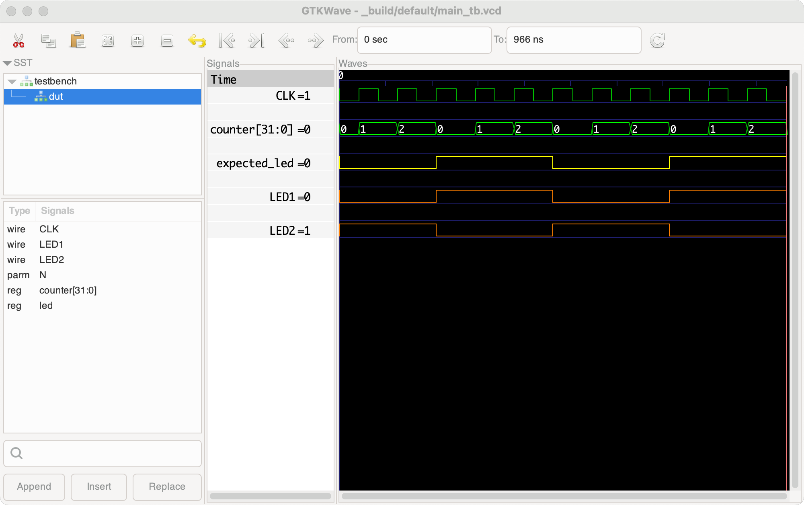

# Logix IDE

[](https://github.com/openlogix/logix-ide/actions/workflows/build-pre-release.yaml)
[](https://github.com/openlogix/logix-ide/actions/workflows/test.yaml)
[](https://github.com/openlogix/logix-ide/actions/workflows/publish-docs.yaml)

**"The Arduino experience, for FPGAs."**

[Website](https://www.openlogix.org/ide/) · [Documentation](https://openlogix.github.io/logix-ide/) · [Download](https://github.com/openlogix/logix-ide/releases)

Logix is a simple, friendly app for programming FPGAs. If you've used the
Arduino IDE, you already know how it works: write your design, click
**Verify** to check it, and click **Upload** to put it on your board. No
command line, no complicated setup.


## What's an FPGA, and why Logix?

An FPGA is a chip you can rewire with code. Instead of running a program
step by step like a microcontroller, it *becomes* the circuit you describe:
counters, blinking LEDs, video signals, even a whole processor. You describe
the circuit in **Verilog**, a hardware description language.

Getting started with FPGAs used to mean installing many tools and learning
their commands. Logix takes care of all of that so you can focus on your
design. It's built on [Apio](https://github.com/FPGAwars/apio) and the open
source FPGA tools, and it downloads everything it needs by itself.

## What you can do

- ✏️ **Write Verilog** in a clean editor with syntax colors. Mistakes are
  underlined as you type.
- ✅ **Verify** your design: Logix checks it for common mistakes, builds it,
  and tells you how much of the FPGA it uses and how fast it can run.
- ⚡ **Upload** it to your board with one click. Logix even tells you when
  your board is connected.
- 📚 **Learn from examples**: more than a hundred ready-to-run examples for
  over a hundred boards, from a blinking LED onwards.
- 🧪 **Test and simulate** your design with testbenches, and look at its
  signals in GTKWave, without a board.
- 🔍 **See your design as a diagram** of its modules and signals.



<sub>GTKWave screenshot from the [Apio](https://github.com/FPGAwars/apio) project.</sub>

## Install Logix IDE

Logix runs on **Macs with Apple Silicon** (M1 or newer) for now. Windows and
Linux are planned.

1. Download the latest `logix-darwin-arm64-<date>.dmg` from the
   [releases page](https://github.com/openlogix/logix-ide/releases) to your
   **Downloads** folder.
2. Open **Terminal** and run this command, using the name of the file you
   downloaded. Logix isn't signed by Apple yet, and this tells your Mac it's
   OK to open it:

   ```
   xattr -c ~/Downloads/logix-darwin-arm64-<date>.dmg
   ```

3. Double-click the `.dmg` file and drag **Logix IDE** into your
   **Applications** folder.
4. Open Logix IDE. The first time, it downloads the FPGA tools it needs. This
   takes a few minutes and needs an internet connection. After that, Logix
   starts quickly and works offline too.

That's it: nothing else to install.

### Is it safe to install?

It's wise to be careful with apps from the internet, so here's how Logix
earns your trust:

- **Fully open source.** All of Logix's code is public, right here in this
  repository. Anyone can read it, check it, and suggest improvements. It's
  free to use, change and share under the
  [Apache License 2.0](LICENSE), except for using the name Logix.
- **Built in the open.** Every installer is built by GitHub's servers from
  this public code, using public build scripts
  ([`.github/workflows`](.github/workflows)). No installer is ever built on
  someone's personal computer, and each release lists the exact code
  version it was built from.
- **Scanned for viruses.** Each installer is automatically scanned with
  [ClamAV](https://www.clamav.net/), an open source antivirus, before it's
  published.
- **Made by the Apio maintainer.** Logix is made by the main maintainer of
  [Apio](https://github.com/FPGAwars/apio), the open source FPGA toolchain
  Logix runs on, with one goal: making FPGAs accessible and fun for
  everyone.

**Why the Terminal step, then?** Apple asks app makers to pay for a yearly
developer account to "sign" their apps. Logix isn't signed that way yet, so
macOS is cautious with it by default. The `xattr -c` command only tells your
Mac that you chose to open this file you downloaded. It doesn't change any
security setting on your Mac.

## Your first blinking LED

1. Start Logix and wait for **Ready.** at the bottom of the window. Logix
   opens a first project for the **Alhambra II** board. Have a different
   board? Choose it in the list at the top, then pick its **blinky** example.
2. Click **Verify** (the ✓ button). Logix builds the design and shows how
   much of the FPGA it uses.
3. Plug in your board. When Logix sees it, the word next to the board list
   changes to **Connected**.
4. Click **Upload** (the → button). Your board's LED starts blinking! 🎉
5. Now make it your own: change the blinking speed, save with ⌘S, and upload
   again.

The [Quick start](https://openlogix.github.io/logix-ide/quick-start/) guide walks
through these steps with pictures.

## Learn more

The [Logix documentation](https://openlogix.github.io/logix-ide/) covers everything,
in short, beginner-friendly pages:

- [Installing](https://openlogix.github.io/logix-ide/installing/)
- [Quick start](https://openlogix.github.io/logix-ide/quick-start/)
- [Using Logix](https://openlogix.github.io/logix-ide/using-logix/)
- [Testbenches and simulation](https://openlogix.github.io/logix-ide/testbenches/)
- [Troubleshooting](https://openlogix.github.io/logix-ide/troubleshooting/)

You can also open these pages from Logix's **Help** menu.

## Need help or found a problem?

Check [Troubleshooting](https://openlogix.github.io/logix-ide/troubleshooting/)
first. If you're still stuck, choose **Help > Report a Problem** in Logix, or
[open an issue on GitHub](https://github.com/openlogix/logix-ide/issues/new). It
helps a lot to attach Logix's log: **Help > Show Log Folder**, then drag
`logix.log` into your report.

## Thanks

Logix stands on the shoulders of great open source projects:
[Apio](https://github.com/FPGAwars/apio) and the
[FPGAwars](https://fpgawars.github.io/) community, Yosys, nextpnr, Icarus
Verilog, Verilator, Verible, GTKWave and more. Thank you!

## For developers

Want to change Logix itself? See [DEVELOPERS.md](DEVELOPERS.md).

## Trademarks

Logix is not affiliated with or endorsed by Arduino. Arduino is a trademark of Arduino SA.
Logix only compares itself to the Arduino IDE to describe how it feels.

## License

Logix is licensed under the [Apache License 2.0](LICENSE): you can use,
copy, change, share and sell it, as long as you keep the license and
copyright notices and mark the files you changed.

The one exception is the **name "Logix"**, which isn't part of that (the
license doesn't give rights to names or trademarks). If you make your own version,
please give it a different name, so people can tell it apart from the
original.
