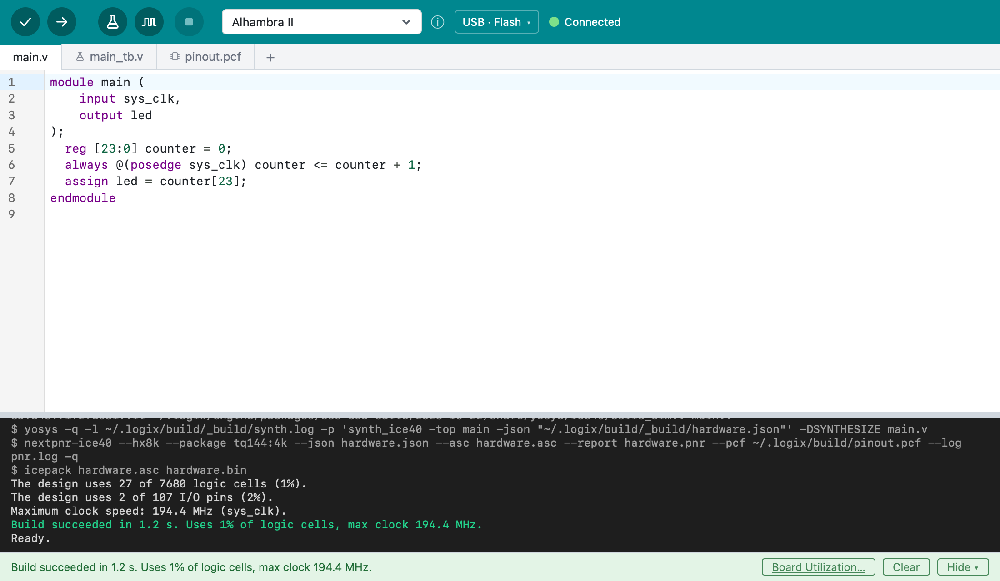
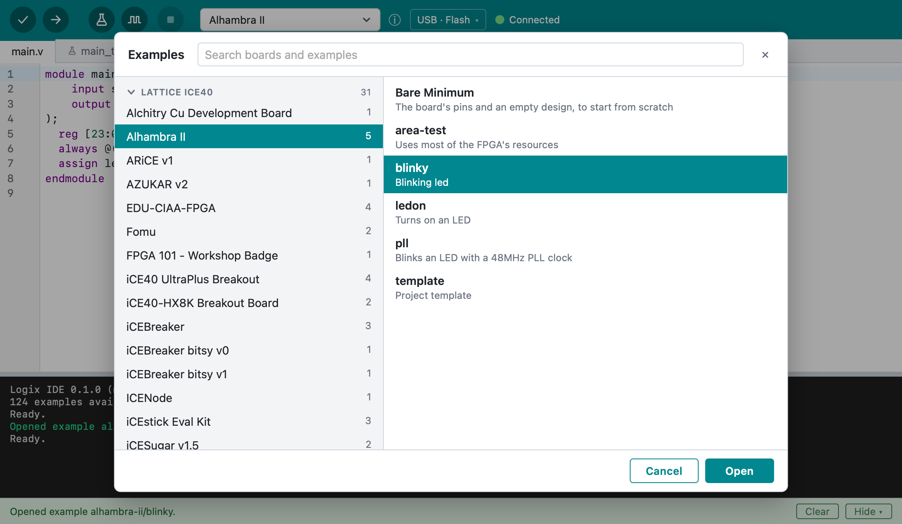
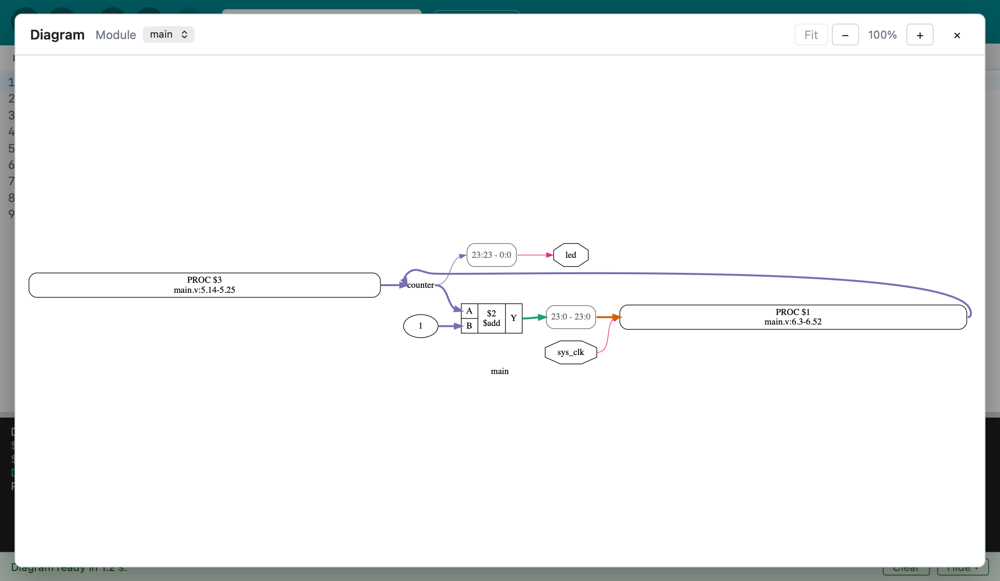
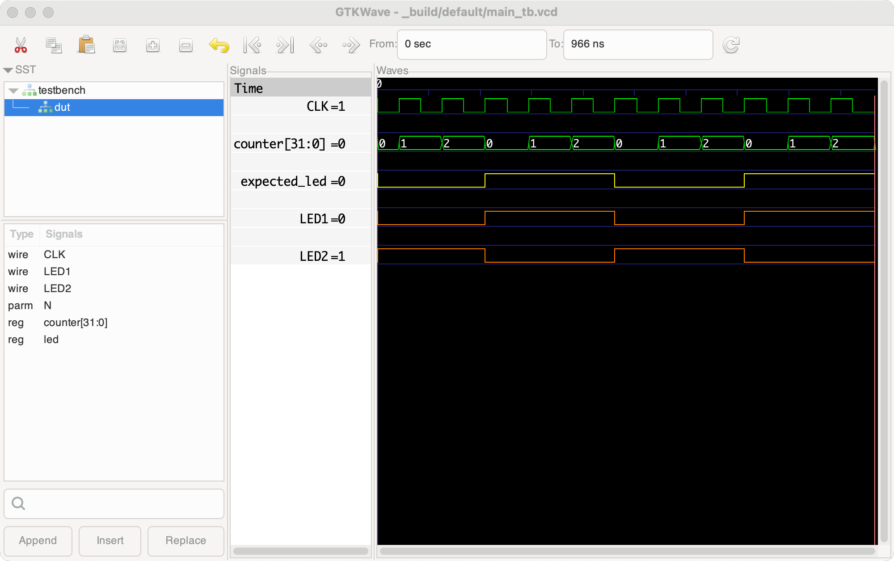

<picture>
  <source media="(prefers-color-scheme: dark)" srcset="https://www.openlogix.org/brand/readme/ide-dark.svg">
  
</picture>

<br>

[](#license)


[](https://github.com/openlogix/logix-ide/actions/workflows/test.yaml)
[](https://github.com/openlogix/logix-ide/actions/workflows/build-pre-release.yaml)
[](https://github.com/openlogix/logix-ide/actions/workflows/publish-docs.yaml)

**[Main page](https://www.openlogix.org/ide/)** · [Docs](https://www.openlogix.org/logix-ide/) · [Download](https://github.com/openlogix/logix-ide/releases) · GitHub (here)

**The Arduino experience, for FPGAs.**

Logix IDE is a simple, friendly app for programming FPGA boards. If you've used the
Arduino IDE, you already know how it works: write your design, click
**Verify** to check it, and click **Upload** to put it on your board. No
command line, no complicated setup.



## What's an FPGA, and why Logix IDE?

An FPGA is a chip you can rewire with code. Instead of running a program
step by step like a microcontroller, it *becomes* the circuit you describe:
counters, blinking LEDs, video signals, even a whole processor. You describe
the circuit in **Verilog**, a hardware description language.

Getting started with FPGAs used to mean installing many tools and learning
their commands. Logix IDE takes care of all of that so you can focus on your
design. It's built on [Logix Engine](https://github.com/openlogix/logix-engine)
and the open source FPGA tools, and it downloads everything it needs by
itself.

## What you can do

- ✏️ **Write Verilog** in a clean editor with syntax colors. Mistakes are
  underlined as you type.
- ✅ **Verify** your design: Logix IDE checks it for common mistakes, builds it,
  and tells you how much of the FPGA it uses and how fast it can run.
- ⚡ **Upload** it to your board with one click. Logix IDE even tells you when
  your board is connected.
- 📚 **Learn from examples**: more than 110 ready-to-run examples for
  over 80 boards, from a blinking LED onwards.
- 🧪 **Test and simulate** your design with testbenches, and look at its
  signals in GTKWave, without a board.
- 🔍 **See your design as a diagram** of its modules and signals.






<sub>GTKWave screenshot from the [Apio](https://github.com/FPGAwars/apio) project.</sub>

## Install Logix IDE

Logix IDE runs on **Macs with Apple Silicon** (M1 or newer) for now. Windows and
Linux are planned.

1. On the [releases page](https://github.com/openlogix/logix-ide/releases), find the release marked
   **Latest** (not necessarily the newest one: newer pre-releases are
   development builds) and download its `logix-darwin-arm64-<date>.dmg` to
   your **Downloads** folder.
2. Open **Terminal** and run this command, using the name of the file you
   downloaded. Logix IDE isn't signed by Apple yet, and this tells your Mac it's
   OK to open it:

   ```
   xattr -c ~/Downloads/logix-darwin-arm64-<date>.dmg
   ```

3. Double-click the `.dmg` file and drag **Logix IDE** into your
   **Applications** folder. Dragging only copies it: nothing opens, and that's
   expected.
4. Start Logix IDE: open **Finder**, click **Applications** in the sidebar and
   double-click **Logix IDE** (or press Command-Space, type `Logix IDE` and
   press Return). The first time, it downloads the FPGA tools it needs. This
   takes a few minutes and needs an internet connection. After that, Logix IDE
   starts quickly and works offline too.

That's it: nothing else to install.

### Is it safe to install?

It's wise to be careful with apps from the internet, so here's how Logix IDE
earns your trust:

- **Fully open source.** All of Logix IDE's code is public, right here in this
  repository. Anyone can read it, check it, and suggest improvements. It's
  free to use, change and share under [MIT](LICENSE-MIT) or the
  [Apache License 2.0](LICENSE-APACHE), at your option, except for using
  the name Logix.
- **Built in the open.** Every installer is built by GitHub's servers from
  this public code, using public build scripts
  ([`.github/workflows`](.github/workflows)). No installer is ever built on
  someone's personal computer, and each release lists the exact code
  version it was built from.
- **Scanned for viruses.** Each installer is automatically scanned with
  [ClamAV](https://www.clamav.net/), an open source antivirus, before it's
  published.
- **Made by the Apio maintainer.** Logix IDE is made by the main maintainer of
  [Apio](https://github.com/FPGAwars/apio), the open source FPGA toolchain
  whose tools and examples Logix IDE builds on, with one goal: making FPGAs
  accessible and fun for everyone.

**Why the Terminal step, then?** Apple asks app makers to pay for a yearly
developer account to "sign" their apps. Logix IDE isn't signed that way yet, so
macOS is cautious with it by default. The `xattr -c` command only tells your
Mac that you chose to open this file you downloaded. It doesn't change any
security setting on your Mac.

## Your first blinking LED

1. Start Logix IDE and wait for **Ready.** at the bottom of the window. Choose
   your board in the list at the top (the **iCESugar v1.5** at first), then
   click **Examples…** on the start screen and open **blinky**.
2. Click the **Verify** button .
   Logix IDE builds the design and shows how much of the FPGA it uses.
3. Plug in your board. When Logix IDE sees it, the word next to the board list
   changes to **Connected**.
4. Click the **Upload** button .
   Your board's LED starts blinking! 🎉
5. Now make it your own: change the blinking speed, save it with
   **File > Save Project**, and upload again.

[Getting started](https://www.openlogix.org/logix-ide/getting-started/) walks
through these steps with pictures.

## Learn more

The [Logix IDE documentation](https://www.openlogix.org/logix-ide/) covers everything,
in short, beginner-friendly pages:

- [Getting started](https://www.openlogix.org/logix-ide/getting-started/)
- [Installing](https://www.openlogix.org/logix-ide/installing/)
- [Tour](https://www.openlogix.org/logix-ide/tour/)
- [Using Logix IDE](https://www.openlogix.org/logix-ide/using-logix/)
- [Testbenches and simulation](https://www.openlogix.org/logix-ide/testbenches/)
- [Troubleshooting](https://www.openlogix.org/logix-ide/troubleshooting/)

You can also open these pages from Logix IDE's **Help** menu.

## Need help or found a problem?

Check [Troubleshooting](https://www.openlogix.org/logix-ide/troubleshooting/)
first. If you're still stuck, choose **Help > Report a Problem** in Logix IDE, or
[open an issue on GitHub](https://github.com/openlogix/logix-ide/issues/new). It
helps a lot to attach Logix IDE's log: **Help > Show Log Folder**, then drag
`logix.log` into your report.

## Thanks

Logix IDE stands on the shoulders of great open source projects:
[Apio](https://github.com/FPGAwars/apio) and the
[FPGAwars](https://fpgawars.github.io/) community, Yosys, nextpnr, Icarus
Verilog, Verilator, Verible, GTKWave and more. Thank you!

## For developers

Want to change Logix IDE itself? See [DEVELOPERS.md](DEVELOPERS.md).

## Trademarks

Logix IDE is not affiliated with or endorsed by Arduino. Arduino is a trademark of Arduino SA.
Logix IDE only compares itself to the Arduino IDE to describe how it feels.

## License

Logix IDE is licensed under [MIT](LICENSE-MIT) or the
[Apache License 2.0](LICENSE-APACHE), at your option: you can use, copy,
change, share and sell it, as long as you keep the copyright and license
notices.

The one exception is the **name "Logix"**, which isn't part of that (the
license doesn't give rights to names or trademarks). If you make your own version,
please give it a different name, so people can tell it apart from the
original.
