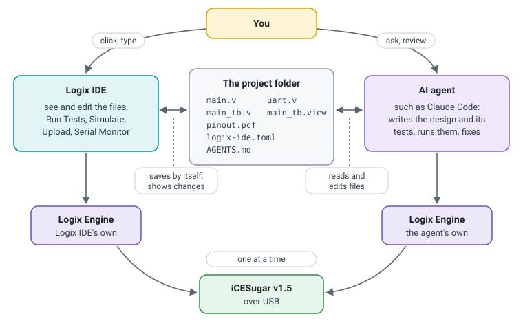

# Using Logix IDE with an AI agent

You can keep a project open in Logix IDE while an AI agent, such as Claude
Code, works on the same project: it edits files, adds and deletes them,
builds, tests and programs the board, and you see its changes as it makes
them.



This page explains how that works and how to set up the agent, then walks
you through a [tutorial](#tutorial-a-morse-code-beacon) in which the agent designs
real hardware while you watch. The last sections are the project's rules,
for the agent.

## Working side by side

- **Your changes reach the agent.** Logix IDE saves a saved project's
  changes by itself, a second after you stop typing and as soon as you
  switch to another app, so the agent always reads what you see (Settings,
  **Save changes automatically**, on by default).
- **The agent's changes reach you.** When the agent changes the project
  folder, Logix IDE shows it at once, without asking: changed files reload
  in their tabs, new files get tabs, deleted files lose theirs, and a board
  the agent chooses in `logix-ide.toml` shows in the toolbar. **Undo** goes
  back past a change, so if you were typing in the same file at that
  moment, your text comes back.
- **One board, one user at a time.** Logix IDE and the agent each have
  their own Logix Engine, and only one program at a time can open a board's
  serial port. Before the agent uploads to the board or reads its serial
  port, choose **Disconnect** in Logix IDE's Serial Monitor, and don't
  upload from both at once.

## Setting up the agent

The agent needs its own Logix Engine, which gives it the FPGA tools. Once
per computer, start Claude Code in your project folder and ask it to
install the engine:

```text
Install Logix Engine for me. Follow "Install the engine yourself" at
https://www.openlogix.org/logix-engine/tutorial-claude-code/
```

Claude downloads the engine, checks that it runs and connects it to Claude
Code; then restart Claude Code (`/exit`, then `claude`). Steps 1 and 2 of
[Logix Engine's tutorial](https://www.openlogix.org/logix-engine/tutorial-claude-code/)
show it in detail.

## Tutorial: a Morse code beacon

In this tutorial the agent designs real hardware for you while you watch
in Logix IDE. You ask, in plain words, for your board's LED to blink a
message in Morse code; the agent works out your board's clock and LED,
writes the Verilog and a testbench that reads the blinks back into text,
finds and fixes its own mistakes, and you check its work in Logix IDE's
waveforms, then upload it and watch the LED spell the message. It takes
about 20 minutes.

You need a board with an LED (almost every board Logix IDE supports has
one; the steps show the iCESugar v1.5) and its USB cable, Logix IDE,
installed and started once (see the [Tutorial](tutorial.md) if it's new to
you), and the agent, set up as above.

### 1. Make a project

1. In Logix IDE, pick your board in the toolbar, then choose
   **File > New Project**.
2. Choose **File > Save Project As…** and name it `morse-beacon`. Logix IDE
   also writes `AGENTS.md` into the folder, the few rules an agent needs
   for a Logix IDE project.
3. Choose **Project > Copy Project Folder Path**.
4. Open a terminal, type `cd ` and paste the path, then start the agent:

    ```text
    claude
    ```

Keep Logix IDE and the terminal side by side, so you see both.

### 2. Describe what you want

Paste this into the agent, or write it in your own words:

```text
This is a Logix IDE project. Make the board's LED blink HELLO FPGA in
Morse code, over and over, at about 10 words a minute. Put the beacon in
its own module, so I can reuse it.

Write the testbench first: it should read the LED's blinks back into
text, the way a person who knows Morse would, with its own Morse table,
and check every dot, dash and gap. Then write the design and run the
tests until they pass. Then build it and tell me how much of the FPGA it
uses. Don't upload: I'll do that.
```

Then watch. A good agent:

- **reads the board before writing for it.** It asks its Logix Engine
  about your board and finds what you didn't have to know: the clock's
  frequency, which pin the LED is on, and whether it lights when that pin
  is 0 or 1. On the iCESugar v1.5 the LED is an RGB LED on the FPGA's RGB
  LED driver, which a design must drive through the `SB_RGBA_DRV` cell;
  that's in the board's data for AI agents.
- **plans the hardware.** A timer that ticks once per Morse unit, worked
  out from the clock; a table of each letter's dots and dashes; and a
  small state machine that turns the LED on for a dot (1 unit) or a dash
  (3 units) and off for the gaps (1 unit inside a letter, 3 between
  letters, 7 between words).
- **tests before trusting.** It writes a testbench with a much shorter
  unit, so it runs in a moment, that measures every on and off time,
  turns them back into letters with its own table and checks that it
  reads `HELLO FPGA HELLO FPGA`. A wrong letter or a gap of the wrong
  length fails the test.

In Logix IDE, the new and changed files show up in their tabs as the agent
writes them. You can read along, or keep typing yourself: Logix IDE saves
your changes so the agent sees them too.

### 3. When a test fails

The agent's first try often fails a test, and that's the interesting
part: it reads the failure, finds the cause, and fixes it. For example, a
gap one unit too short fails with "an off time of 24 cycles: not a gap of
1, 3 or 7 units", and a mistake in the table with "expected HELLO FPGA
HELLO FPGA, got SELLO FPGA SELLO FPGA": the H came out as an S.

You can watch the same failure in Logix IDE: choose **Run Tests**. A
failing check is marked at its line in the testbench, and its message is
in the output.

!!! tip "Ask why"
    Ask the agent to explain what it changed and why, in a sentence or
    two. Reading its reasons is the fastest way to learn the design, and
    to notice when it's wrong.

### 4. See the dots and dashes

Once the tests pass, choose **Simulate** in Logix IDE. The Waveforms
window opens on the testbench's run.

1. In **Signals in the file**, tick the LED signal and the testbench's
   decoded text (the agent names them; ask it which they are). The LED
   row shows the message as short and long pulses.
2. Right-click the text and choose **ASCII** under **Show values as**: it
   spells the message one letter at a time, each one right after its
   dots and dashes.

Logix IDE saves this view with the project, so it's there next time.

### 5. Ask for more

Now give the agent a harder job, one that changes how the design works:

```text
After each HELLO FPGA, send a number that counts up: HELLO FPGA 1,
HELLO FPGA 2, and so on, up to 99, then start again at 1. Keep the tests
passing, and add a test for 9 to 10 and for 99 back to 1.
```

A good agent adds a counter in decimal digits, sends its digits with the
digits' Morse codes, and teaches the testbench to read them. Choose
**Project > Show Diagram** in Logix IDE to see how its new parts connect,
and **Project > Board Utilization…** to see what they cost.

### 6. Try it on the board

1. Connect your board.
2. In Logix IDE, choose **Upload**.
3. Watch the LED: three long flashes are an O, four short ones an H. If
   you don't read Morse, compare it with the waveform, or point a phone's
   Morse code reader app at it.

Only one program at a time can use the board: if the agent is to upload
to it itself, don't upload from both at once.

### Make it yours

Some ideas to ask the agent for:

- Your own message, or a faster speed you set with a parameter.
- On a board with a button: send SOS while it's held.
- On a board with several LEDs: light one more LED for each letter sent,
  as a progress bar.
- On an RGB LED: a different color for each word.

Whatever you ask, ask for a test first, and look at the waveform before
the board: that's where hardware bugs are easiest to see.

### Starting with the agent instead

If you start the agent before Logix IDE has made a project, give it this
page first, so it makes a Logix IDE project rather than one of its own
kind:

```text
I use Logix IDE. Read https://www.openlogix.org/logix-ide/ai-agents/ and
make a Logix IDE project for my iCESugar v1.5 that blinks its LED.
```

Then open the folder in Logix IDE with **File > Open Project…**.

## Telling the agent about the project

Every project Logix IDE creates has two small files for AI agents, added
when you first save it:

- **`AGENTS.md`**, read by many agents: it says the folder is a Logix IDE
  project, gives the main rules below in a few lines, and links to this
  page, as it was for your version of Logix IDE.
- **`CLAUDE.md`**, read by Claude Code: one line that includes `AGENTS.md`.

Logix IDE doesn't show them as tabs, and never changes them after that: you
can add your own rules. A project made before Logix IDE added them has
none; an agent still works, and you can copy the two files from a new
project.

## The project model, for AI agents

A Logix IDE project follows these rules. They differ from Logix Engine's
default project model (which keeps the board in `logix.json`): in a Logix
IDE project, follow these.

- **One folder** holds the project, with every file at its top level.
  Logix IDE uses only the top level; other files and folders are kept and
  go along to builds.
- **`main.v`** holds the top module, `main` (or **`main.sv`** for
  SystemVerilog). It's always there and is never renamed.
- **Other source files** (`.v`, `.sv`) and include files (`.vh`, `.svh`)
  sit next to it.
- **Testbenches** are named `<name>_tb.v` (or `_tb.sv`), next to the code
  they test, such as `adder_tb.v` for `adder.v`. They report failures with
  `$error` and end with `$finish`.
- **One pin file** in the board's format: `pinout.pcf` (iCE40),
  `pinout.lpf` (ECP5), `pinout.cst` (Gowin) or `pinout.xdc` (Xilinx). Logix
  Engine's `get_catalog` gives the board's FPGA.
- **`logix-ide.toml`** holds the project's settings: `board` (a board ID),
  `[variant]` (how the board is connected and programmed) and `[serial]`
  (the Serial Monitor's speed). Change only what you need, and keep its
  other lines. Don't add a `logix.json`.
- **Waveform views** are named `<testbench>.view`, next to the testbench,
  such as `main_tb.view`. Logix IDE's Waveforms window writes them; leave
  them as they are.
- **Folders starting with `_` are generated**, such as `_build`: build
  into `_build` inside the project, and never put sources there.
- **File names** have no spaces.

When building with Logix Engine, send the project folder as
`source_folder`, `main` as `top_module`, the project's source files
without the testbenches as `source_files`, the pin file as
`constraint_file`, and the board and variant from `logix-ide.toml`.
