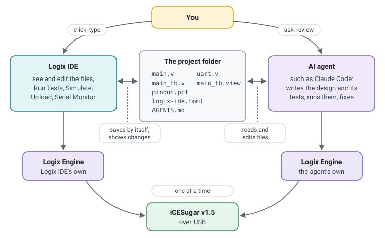

# Tutorial: a mood light, with an AI agent

In this tutorial an AI agent designs real hardware for you while you watch
in Logix IDE. You describe a mood light for the iCESugar v1.5's RGB LED in
plain words; the agent writes the Verilog and the tests, finds and fixes
its own mistakes, and you check its work in Logix IDE's waveforms, then
upload it and set colors from the Serial Monitor.

It takes about 30 minutes. You need:

- an [iCESugar v1.5](https://www.openlogix.org/logix-catalog/boards/) and
  its USB-C cable (any board with an LED and a serial port works, with
  small changes to the words);
- Logix IDE, installed and started once (see the [Tutorial](tutorial.md)
  if it's new to you);
- an AI agent that can use MCP servers, such as
  [Claude Code](https://www.anthropic.com/claude-code), set up as in
  [Using Logix IDE with an AI agent](ai-agents.md#setting-up-the-agent).



You and the agent work on the same project folder. Logix IDE saves your
changes by itself and shows the agent's as they happen; each side has its
own Logix Engine with the FPGA tools, and the board is used by one side at
a time.

## 1. Start from the serial example

The agent works best from a design that already talks to the computer.

1. In Logix IDE, choose **File > Examples…**, pick the **iCESugar v1.5**,
   then **serial**, and choose **New Project**.
2. Choose **File > Save Project As…** and name it `mood-light`. Logix IDE
   also writes `AGENTS.md` into the folder, the few rules an agent needs
   for a Logix IDE project.
3. Choose **Project > Copy Project Folder Path**.
4. Open a terminal, type `cd ` and paste the path, then start the agent:

    ```text
    claude
    ```

Keep Logix IDE and the terminal side by side, so you see both.

## 2. Describe what you want

Paste this into the agent, or write it in your own words:

```text
This is a Logix IDE project for the iCESugar v1.5. Turn it into a mood
light: when I type a color such as #FF8000 and Enter in the Serial
Monitor, the RGB LED fades smoothly to that color in about half a second.
Anything that isn't # and six hex digits leaves the color as it is.

Write the testbench first, in main_tb.v, then the design, and run the
tests until they pass. Then build it and tell me how much of the FPGA it
uses. Don't upload: I'll do that.
```

Then watch. A good agent:

- **reads the board before writing for it.** It asks its Logix Engine
  about the iCESugar v1.5 and finds that the RGB LED isn't on plain pins:
  it's on the FPGA's RGB LED driver, which a design must drive through the
  `SB_RGBA_DRV` cell. That's in the board's data for AI agents, not
  something you had to know.
- **plans the hardware.** Three 8-bit brightness levels, one per color; a
  PWM counter that turns each color on for its share of the time; a slow
  step that moves each level one notch toward the color you typed, so it
  fades instead of jumping; and a small reader that collects `#` and six
  hex digits from the serial line.
- **tests before trusting.** It writes `main_tb.v` to type `#FF8000` into
  the design, the way the Serial Monitor would, and checks that the
  levels reach 255, 128 and 0, and that a typo changes nothing.

In Logix IDE, the new and changed files show up in their tabs as the agent
writes them. You can read along, or keep typing yourself: Logix IDE saves
your changes so the agent sees them too.

## 3. When a test fails

The agent's first try often fails a test, and that's the interesting
part: it reads the failure, finds the cause, and fixes it. For example, a
testbench that types `"#FF8000\r"` never sends Enter, because Verilog-2005
has no `\r` escape; the color never changes, the test says "Expected
16744448, got 0", and the agent rewrites Enter as `\015`. Or the fade
overshoots by one step and never settles.

You can watch the same failure in Logix IDE: choose **Run Tests**. A
failing check is marked at its line in `main_tb.v`, and its message is in
the output.

!!! tip "Ask why"
    Ask the agent to explain what it changed and why, in a sentence or
    two. Reading its reasons is the fastest way to learn the design, and
    to notice when it's wrong.

## 4. See the fade

Once the tests pass, choose **Simulate** in Logix IDE. The Waveforms
window opens on the testbench's run.

1. In **Signals in the file**, open `dut` and tick `target`, `red`,
   `green` and `blue`.
2. Right-click `red` and choose **Show as analog (a line)**; do the same
   for `green`. The levels draw as ramps: red climbs to the top, green to
   half, as the fade promised.
3. Right-click `target` and choose **Hex** under **Show values as**: it
   reads `FF8000` after Enter.

Logix IDE saves this view with the project, so it's there next time.

## 5. Ask for more

Now give the agent a harder job, one that changes how the design works:

```text
At low levels the LED brightens too fast and then barely changes. Make
the fade look even to the eye, with a gamma table, and keep the tests
passing. Then add a "rainbow" command that cycles through the colors
until I type another one, with a test for it.
```

A good agent explains that eyes see brightness on a curve, adds a table
that maps each level to a PWM value, updates the testbench, and runs
everything again. Choose **Project > Show Diagram** in Logix IDE to see
how its new parts connect, and **Project > Board Utilization…** to see
what they cost.

## 6. Try it on the board

1. Connect the iCESugar v1.5 (and no other iCESugar board).
2. In Logix IDE, choose **Upload**.
3. Open **Tools > Serial Monitor**, type `#FF8000` and press Enter. The
   LED fades to orange. Try `#0000FF`, `#202020` and `rainbow`.

Only one program at a time can use the board: if the agent is to upload
or read the serial port itself, choose **Disconnect** in the Serial
Monitor first, and don't upload from both at once.

## Make it yours

Some ideas to ask the agent for:

- Use the iCESugar v1.5's DIP switches to pick four favorite colors.
- Send back `OK #FF8000` after each color, so the Serial Monitor shows
  what the light is doing.
- A slow "breathing" mode, or a fade speed you set with `/` and a number.

Whatever you ask, ask for a test first, and look at the waveform before
the board: that's where hardware bugs are easiest to see.
