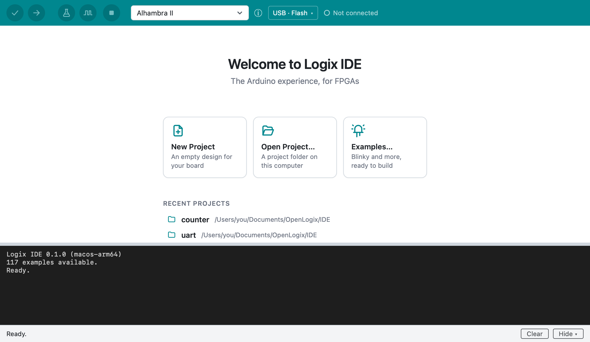
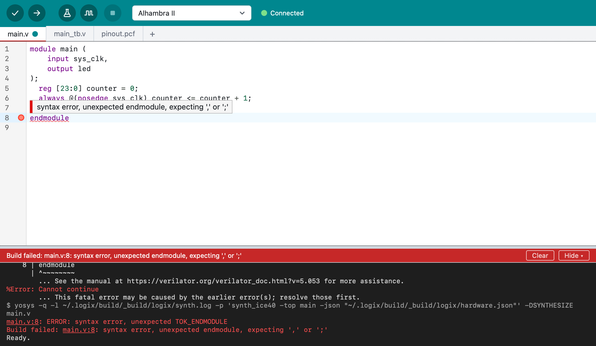
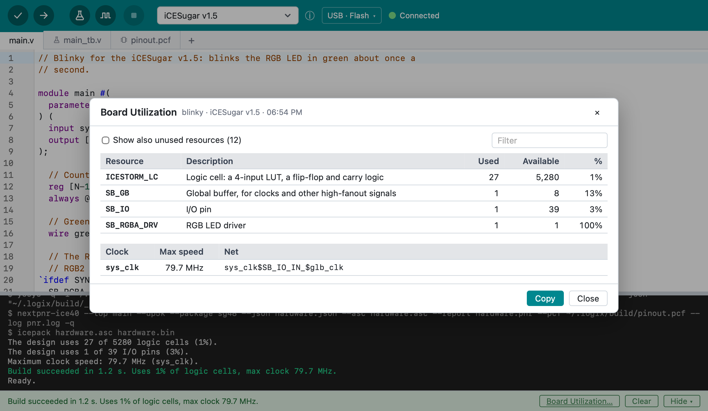

# Getting started

This page takes you from nothing to your own design running on an FPGA
board. You'll install Logix IDE, open an example that blinks an LED, look at
what the tools tell you about it, upload it to your board, and then change it
and save it as your own project.

The steps use the **iCESugar v1.5** board as the example. They're the same for
every board Logix IDE supports; only the example's details differ.

## What you need

- A computer:

    === "macOS"

        A Mac with **Apple Silicon** (M1 or newer) and macOS 11 or newer.

    === "Windows"

        A 64-bit (x64) PC with Windows 10 or 11.

- An **FPGA board** and the USB cable that connects it to your computer. You
  can follow most of this page without a board; only the upload needs one.
- An internet connection the first time you start Logix IDE.

The steps that differ between macOS and Windows have a tab for each: choose
yours once, and every tab on these pages follows.

There's nothing else to install: Logix IDE downloads the FPGA tools it needs.

## 1. Install Logix IDE

=== "macOS"

    Install Logix IDE as [Installing](installing.md) describes: download it,
    allow it to open, and drag it into the **Applications** folder.

=== "Windows"

    Install Logix IDE as [Installing](installing.md) describes: download the
    `.msi` installer, allow it to run, and follow its steps.

## 2. Start Logix IDE

=== "macOS"

    Open **Finder**, click **Applications** in the sidebar and double-click
    **Logix IDE** (or press Command-Space, type `Logix IDE` and press
    Return). Dragging it into Applications only copied it, so this is its
    first start.

=== "Windows"

    Open the **Start** menu and click **Logix IDE** (or press the Windows
    key, type `Logix IDE` and press Enter).

The first time, Logix IDE downloads its FPGA tools, which takes a few minutes. The status bar at the
bottom of the window shows the progress, and the output area above it shows
what's happening:

```
Downloading the examples 2026.11.12...
The examples 2026.11.12 downloaded.
Downloading Logix Engine 2026.11.12...
Logix Engine 2026.11.12 downloaded.
Downloading the FPGA tools. The first time can take a few minutes.
Downloading logix-core 2026.11.11...
FPGA tools downloaded (logix-core).
117 examples available.
Ready.
```

When the output says **Ready.**, you can start. Later starts take only a
few seconds and work without internet. Logix IDE checks for newer releases
of Logix Engine, its FPGA tools and the examples once a day, when you use it, and downloads
them by itself; **Help > Check for Updates** checks now.

The window shows the start screen, with buttons for a new project, an existing
project and the examples:



## 3. Connect your board and select it

Connect the board to your computer with its USB cable. Then select it in the board
list in the toolbar: type part of its name to find it. The list starts with
the boards you've used recently, followed by every board grouped by FPGA
family. The iCESugar v1.5 is selected at first.

Next to the board list, **Not connected** changes to **Connected** when Logix
IDE finds your board on USB.

## 4. Open the Blinky example

Click **Examples…** on the start screen. The window lists the examples for
your board: select **blinky** and click **New Project**. (On a few boards, the
first example is called **ledon**.)

Blinky opens as a new project. Its files are in tabs above the editor:

- `main.v` is the design, written in Verilog. On the iCESugar v1.5 it blinks
  the RGB LED in green, about once a second. Its comments explain each part.
- `pinout.pcf` is the pin file: it says which FPGA pins connect to what on the
  board, such as the clock and the LED.
- `main_tb.v` is a testbench: it checks the design on your computer, without
  a board.

## 5. Verify the design

Click **Verify** { .toolbar-icon },
the first button in the toolbar. Logix IDE checks the design for common
errors and builds it. The status bar then says how much of the FPGA the
design uses and how fast its clock can run:

```
Build succeeded in 1.2 s. Uses 1% of logic cells, max clock 79.7 MHz.
```

If there's an error, Logix IDE marks its line in the editor and the status
bar says what's wrong; hover over the mark to read the message. Syntax errors
are marked as you type, before you click Verify:



## 6. Look at the board utilization

Verify's message gives the totals. For the details, choose **Project > Board
Utilization…**: it lists each FPGA resource the design uses, such as logic
cells, RAM blocks and I/O pins, with how many the FPGA has, and the design's
clocks with their maximum speeds.



## 7. See the design as a diagram

Choose **Project > Show Diagram**. Logix IDE draws the design as a schematic
in a window of its own: the counter's register, the adder that counts, and the
pins. Hover over a block for its details, and double-click it to see its line
in `main.v`. You can keep the window open while you work: it's drawn again after
each Verify.

## 8. Run the tests

Click **Run Tests** { .toolbar-icon }.
Logix IDE runs the testbench, `main_tb.v`, which drives the design with a
clock and checks that the LED turns on and off when it should. The output says
whether each test passed. Run the tests after every change, to make sure the
design still works.

## 9. Simulate the design

Click **Simulate** { .toolbar-icon }.
Logix IDE runs the testbench too, but instead of a pass or fail result it opens
the design's signals in **GTKWave**, a waveform viewer. There you can see each
signal change over time, such as the counter and the LED, to understand why
the design behaves as it does.

[Testbenches and simulation](testbenches.md) explains both.

## 10. Upload it to the board

With the board connected, click **Upload**
{ .toolbar-icon }, next to Verify.
Logix IDE builds the design if it changed and programs the board. A few
seconds later the LED starts blinking: on the iCESugar v1.5, the RGB LED
blinks green.

=== "macOS"

    No driver is needed: macOS lets Logix IDE program every board as it is.

=== "Windows"

    The iCESugar v1.5 needs no driver. Many other boards, such as those with
    an FTDI chip, need the WinUSB driver first: the first time, Upload asks
    to install it. Click **Install Driver**, then **Yes** when Windows asks
    whether Logix Engine may make changes to your device. Installing takes a
    minute or two, then the upload goes on. See
    [Drivers on Windows](using-logix.md#drivers-on-windows).

The design is stored in the board's flash memory, so it runs again whenever
the board gets power, even without your computer.

## 11. Modify the design

Now make it yours. In `main.v`, the counter's width `N` sets how fast the LED
blinks: each step down doubles the speed. Find this line:

```verilog
parameter N = 24  // Counter width: 2^24 cycles at 12 MHz is about 1.4 s.
```

Change `24` to `22` and click **Upload**. The LED now blinks four times as
fast.

## 12. Save it as your project

Choose **File > Save Project** and give the project a name. Logix IDE creates
a folder for it in your projects folder and lists it under **Recent
projects** on the start screen. The projects folder is, by default:

=== "macOS"

    `~/Documents/OpenLogix/IDE`

=== "Windows"

    `Documents\OpenLogix\IDE` in your user folder

## 13. Explore the boards

Open the board list in the toolbar to see every board Logix IDE supports, 81
so far (the [predefined boards](https://www.openlogix.org/logix-catalog/boards/)). The **ⓘ** button next to the list opens the **Board Explorer**, with
the selected board's facts: its FPGA, what its pins connect to (the clock, LEDs,
buttons), how it's programmed, and its examples.

## 14. Explore the settings

Open the settings to change how Logix IDE works:

=== "macOS"

    Choose **Logix IDE > Settings…** (Command-,).

=== "Windows"

    Choose **File > Settings…** (Ctrl+,).

The settings are:

- **Projects folder location**: where new projects are saved.
- **Editor font size**, **Interface scale** and **Theme** (System, Light or
  Dark).
- **Show the output**: when the output area comes back by itself after you
  hide it.
- **Show lint warnings on Verify**: turn it off to skip the design check.
- **Check code while typing**: mark syntax errors as you type.

## If something goes wrong

| Problem | What to do |
| :--- | :--- |
| macOS says Logix IDE can't be opened | Run the `xattr -c` command from [Installing](installing.md) again, then install it again. |
| Windows says "Windows protected your PC" | Click **More info**, then **Run anyway**: Logix IDE isn't signed yet. |
| On Windows, Upload says the board needs a driver | Click **Install Driver**, then **Yes** in Windows' prompt. See [Drivers on Windows](using-logix.md#drivers-on-windows). |
| The FPGA tools don't download | A red bar shows the problem. Check your internet connection and click **Retry**. |
| Upload can't find the board | Check that **Connected** shows next to the board list, and try another USB cable: some cables only charge. |
| Your board isn't in the list | It isn't supported yet. To ask for it, choose **Help > Report a Problem**. |

[Troubleshooting](troubleshooting.md) covers these and more.

## Next steps

- Take the [tour](tour.md) of the window: the toolbar, the files of a project
  and what each part does.
- Open more examples with **File > Examples…**, such as **rgb-led** on the
  iCESugar v1.5.
- Look up menus, keyboard shortcuts and settings in
  [Using Logix IDE](using-logix.md).
