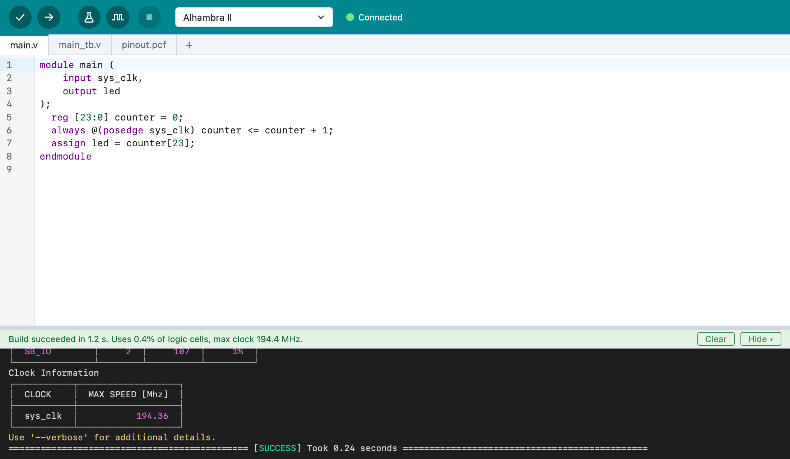

# Logix IDE

**"The Arduino experience, for FPGAs."**

Logix IDE (Logix for short) is a simple IDE for FPGAs, in the spirit of the Arduino IDE. Write your
design in Verilog, click **Verify** to check it and **Upload** to program your
board.

Behind the scenes, Logix uses [Apio](https://github.com/FPGAwars/apio) and its
open source FPGA tools. You don't need to know Apio or install anything else:
Logix downloads what it needs on its first start.

## What Logix does

- **Edit** Verilog and SystemVerilog, with syntax colors, mistakes
  underlined as you type, tabs for the project's files, and Auto Format.
- **Verify** a design: lint it for common mistakes, build it, and see how much
  of the FPGA it uses and how fast it can run.
- **Upload** it to your board; Logix shows when it's connected.
- **Test** it with testbenches, and **simulate** it to see the signals in
  GTKWave.
- **Learn** from more than a hundred examples for over a hundred boards.
- **See** your design as a diagram.

## Platforms

Logix runs on **macOS with Apple Silicon** for now. Windows and Linux are
planned.

## Next steps

- [A tour of Logix](tour.md): what's on the screen and how it all fits together.
- [Install Logix](installing.md)
- [Quick start](quick-start.md): from a new project to a blinking LED.
