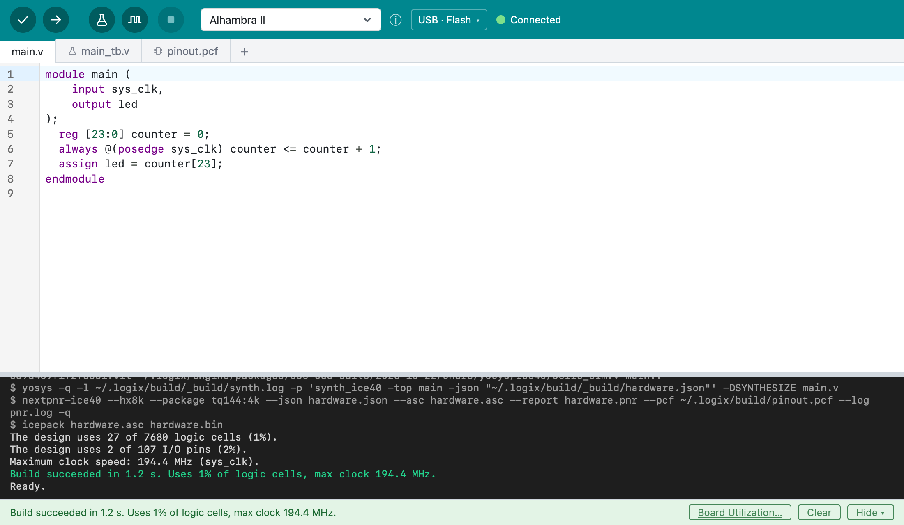

# Logix IDE Docs

These are Logix IDE's docs. Its **main page**, what it is and how to get
it, is [www.openlogix.org/ide](https://www.openlogix.org/ide/); the code is
on [GitHub](https://github.com/openlogix/logix-ide).

**The Arduino experience, for FPGAs.**

Logix IDE is a simple IDE for FPGAs, in the spirit of the Arduino IDE. Write your
design in Verilog, click **Verify** to check it and **Upload** to program your
board.

Behind the scenes, Logix IDE uses open source FPGA tools, through
[Logix Engine](https://www.openlogix.org/engine/). You don't
need to know them or install anything else: Logix IDE downloads what it needs on
its first start.

## What Logix IDE does

- **Edit** Verilog and SystemVerilog, with syntax colors, mistakes
  underlined as you type, tabs for the project's files, and Auto Format.
- **Verify** a design: lint it for common mistakes, build it, and see how much
  of the FPGA it uses and how fast it can run.
- **Upload** it to your board; Logix IDE shows when it's connected.
- **Test** it with testbenches, and **simulate** it to see the signals in
  GTKWave.
- **Learn** from more than 110 examples for over 80 boards.
- **See** your design as a diagram.

## Platforms

Logix IDE runs on **macOS with Apple Silicon** and on **Windows (x64)**. Linux
is planned.

## Next steps

- [A tour of Logix IDE](tour.md): what's on the screen and how it all fits together.
- [Install Logix IDE](installing.md)
- [Tutorial](tutorial.md): from nothing to your own design running on your board.
