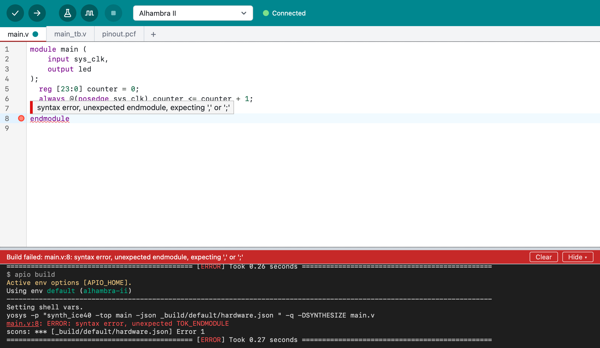

# Quick start

From a new project to a blinking LED in a few steps.

## 1. Choose your board

Start Logix and wait until the output area at the bottom shows **Ready.**
Logix starts with a new project for the **Alhambra II** board, from its basic
example (blinky). If you have another board, choose it in the list in the
toolbar: Logix offers the board's examples. Choose **blinky** (on a few boards
it's called **ledon**) and click **Open**.

The project has everything needed to build: `main.v` (the design), a pin file such
as `pinout.pcf` (which FPGA pins connect to what on the board), and usually a
testbench, `main_tb.v`.

## 2. Verify

Click **Verify** (the check mark, ++cmd+r++). Logix checks the design for
common mistakes, builds it, and shows how much of the FPGA it uses:

```
Build succeeded in 2.4 s. Uses 0.4% of logic cells, max clock 194.4 MHz.
```

If there's a mistake, the line is marked in the editor and the status bar
says what's wrong. Hover over the mark to read the message. Here, a `;` is
missing at the end of line 7, so the tools stop at the next line:



## 3. Upload

Connect your board with a USB cable. Next to the board list, Logix shows
**Connected** when it recognizes the board. Click **Upload** (the arrow,
++cmd+u++): Logix builds the design and programs the board. The LED should
start blinking.

If Logix can't find the board, see
[Troubleshooting](troubleshooting.md#upload-cant-find-the-board).

## 4. Save

Press ++cmd+s++ and give the project a name. Logix creates a folder for it,
in `~/Documents/Logix` by default.

## 5. Explore

- Change the design: make the LED blink faster, add more LEDs, and click
  **Verify** and **Upload** again.
- Open other examples with **File > Examples…** (++shift+cmd+e++).
- Try **Run Tests** and **Simulate**: see
  [Testbenches and simulation](testbenches.md).
- See your design as a diagram: **Project > Show Diagram**
  (++shift+cmd+d++).
