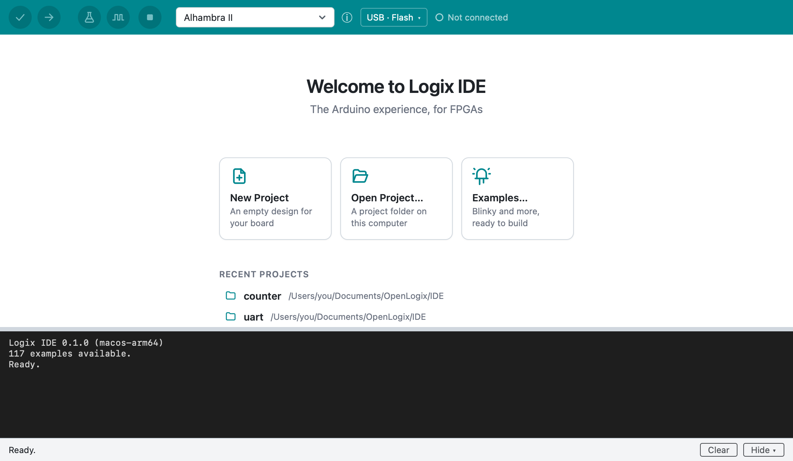
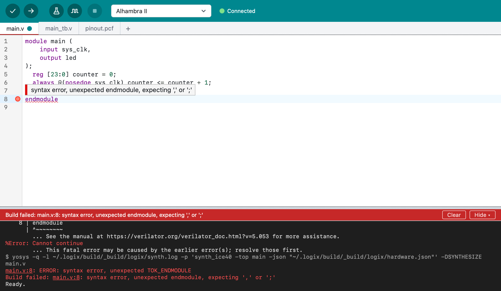

# Quick start

From a new project to a blinking LED in a few steps.

## 1. Choose your board

Start Logix and wait until the output area at the bottom shows **Ready.**
The window shows the start screen. Choose your board in the list in the
toolbar (the **Alhambra II** is selected at first), then click **From
Example…**, pick **blinky** for your board and click **Open**. (On a few
boards the basic example is called **ledon**.)



The project has everything needed to build: `main.v` (the design), a pin file such
as `pinout.pcf` (which FPGA pins connect to what on the board), and usually a
testbench, `main_tb.v`.

## 2. Verify

Click the **Verify** button { .toolbar-icon }. Logix checks the design for
common mistakes, builds it, and shows how much of the FPGA it uses:

```
Build succeeded in 2.4 s. Uses 0.4% of logic cells, max clock 194.4 MHz.
```

If there's a mistake, the line is marked in the editor and the status bar
says what's wrong. Hover over the mark to read the message. Here, a `;` is
missing at the end of line 7, so the tools stop at the next line:



## 3. Upload

Connect your board with a USB cable. Next to the board list, Logix shows
**Connected** when it recognizes the board. Click the **Upload** button
{ .toolbar-icon }: Logix builds the design and programs the board. The LED should
start blinking.

If Logix can't find the board, see
[Troubleshooting](troubleshooting.md#upload-cant-find-the-board).

## 4. Save

Choose **File > Save Project** and give the project a name. Logix creates a folder for it,
in `~/Documents/Logix` by default.

## 5. Explore

- Change the design: make the LED blink faster, add more LEDs, and click
  **Verify** and **Upload** again.
- Open other examples with **File > New Project > From Example…**.
- Try **Run Tests** and **Simulate**: see
  [Testbenches and simulation](testbenches.md).
- See your design as a diagram: **Project > Show Diagram**.
