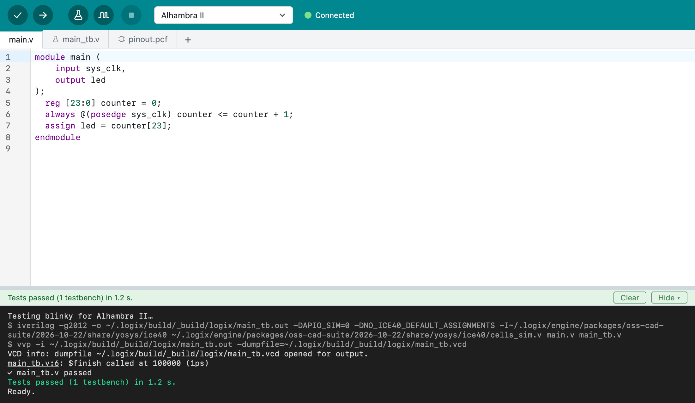
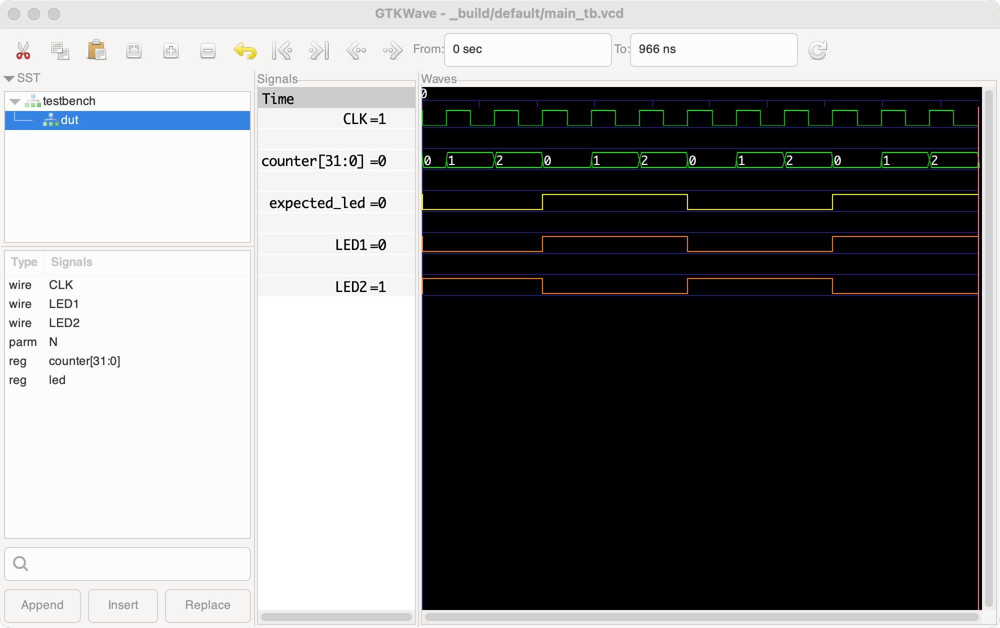

# Testbenches and simulation

A **testbench** is Verilog code that drives your design with inputs and
checks its outputs, without a board. Testbench files end with `_tb.v` (or
`_tb.sv`), e.g. `main_tb.v` for `main.v`. Most examples come with one.

## Run Tests

The **Run Tests** button { .toolbar-icon } runs all the project's
testbenches and shows the result of each:



To run just one, right-click its tab and choose **Run This Test**.

A test fails when the testbench reports an error (`$error` or `$fatal`), or
when it doesn't end with `$finish`. Run Tests stops a testbench at its first
error, and the line that failed is marked in the editor.

## Simulate

The **Simulate** button { .toolbar-icon } runs the testbench that's open
(or the project's only one) and shows its signals in **GTKWave**, a waveform
viewer. The testbench runs to the end even when a check fails, and GTKWave
opens zoomed in around the first failure, so you can see what led up to it.



To keep how GTKWave shows the signals, save it from GTKWave with
**File > Write Save File**. Logix copies the saved layout (a `.gtkw` file)
into the project, and the next simulation uses it.

## Writing a testbench

Create a file whose name ends with `_tb.v` (the **+** at the end of the tabs).
Logix fills it with a starting point:

```verilog
`timescale 1ns / 1ps

module counter_tb;

  initial begin
    $dumpvars(0, counter_tb);

    // Your test steps go here.

    #100;
    $finish;
  end

endmodule
```

Inside, create the module you test, drive its inputs, and check its outputs.
When a check fails, report it with `$error`, with the values in the message:

```verilog
if (actual !== expected)
  $error("expected %h, got %h", expected, actual);
```

Logix finds the line and the time of each error. Don't call `$dumpfile`:
Logix decides where the waveform goes. Use `$fatal` only when going on makes
no sense, such as a missing data file.
