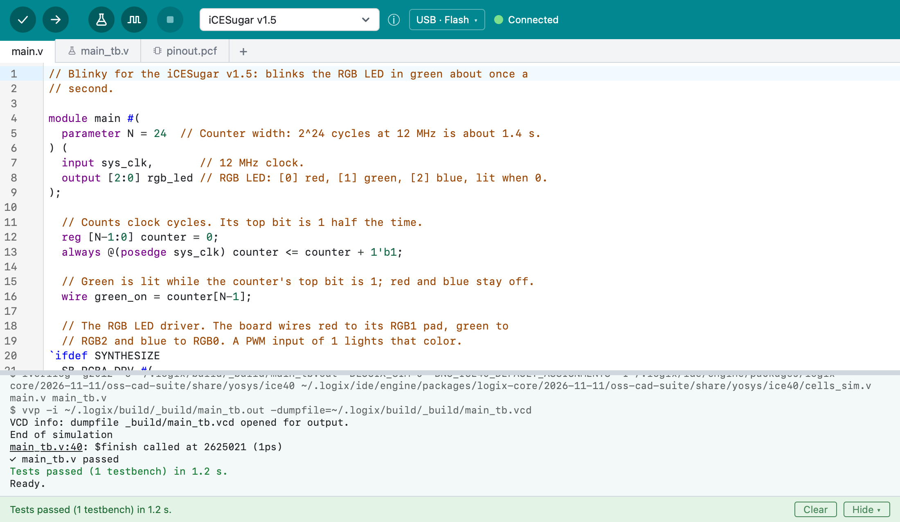
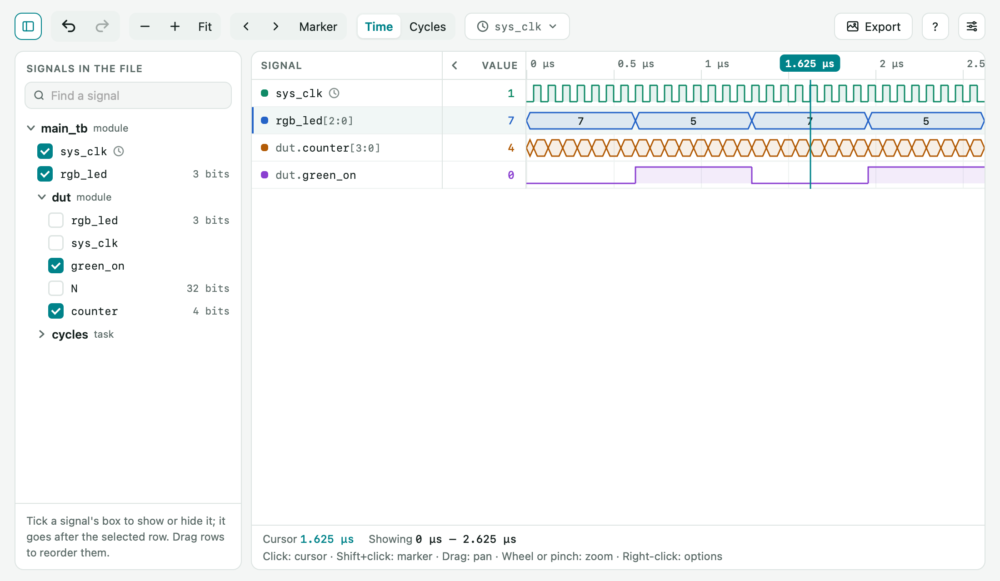

# Testbenches and simulation

A **testbench** is Verilog code that drives your design with inputs and
checks its outputs, without a board. Testbench files end with `_tb.v` (or
`_tb.sv`), e.g. `main_tb.v` for `main.v`. Most examples come with one.

## Run Tests

The **Run Tests** button { .toolbar-icon } runs all the project's
testbenches and shows the result of each:



To run just one, right-click its tab, or right-click in it in the editor,
and choose **Run Test**. **Simulate Test** is there too.

A test fails when the testbench reports an error (`$error` or `$fatal`), or
when it doesn't end with `$finish`. Run Tests stops a testbench at its first
error, and the line that failed is marked in the editor.

## Simulate

The **Simulate** button { .toolbar-icon } runs a testbench and shows its signals in the **Waveforms**
window. Which one: the testbench that's open; else the open file's own
testbench (`main_tb.v` for `main.v`); else the project's only one; else the
one you simulated last. If none of these picks one, Simulate asks which
testbench to run, and runs it again next time. Hover over the button to see
which one it will run. The testbench runs to the end even when a check fails, and the window
opens zoomed in around the first failure, with the check's message above the
signals, so you can see what led up to it.



In the Waveforms window:

- **Zoom** with the mouse wheel or a pinch on the trackpad, around the
  pointer: zoom out, move the pointer to what you want to see, and zoom in.
  Drag to move along in time.
- **Click** to put the cursor there: the **Value** column shows every
  signal's value at that moment. Near a change, the cursor lands right on
  it. **Shift+click** puts a marker, to measure the time between the two.
- **Choose the signals** in the list on the left: tick a signal to show it,
  open a module to see its signals. Drag rows to reorder them, and add
  groups (right-click a row) to give signals a title; click a group to
  fold it.
- **Right-click** anything for what you can do with it, such as showing a
  bus's value in decimal, changing a signal's color, or saving the view as
  an image.
- **A failed check** is a red flag on the time line. **Previous** and
  **Next** go from one failure to the next, and clicking a failure's place,
  such as `main_tb.v:42`, shows that line in the editor.
- Double-click a signal's name to see where it's declared.

What you choose is kept: the window saves it as the testbench's view
(`main_tb.view` for `main_tb.v`), part of your project, and the next
simulation opens the same way. Undo goes back step by step. The view has no tab: you change it only in the Waveforms
window.

## Writing a testbench

Create a file whose name ends with `_tb.v` (the **+** at the end of the tabs).
Logix IDE fills it with a starting point:

```verilog
// Testbench. Run it with Project > Run Tests, or view its signals
// with Project > Simulate.

`timescale 1ns / 1ps

module counter_tb;

  initial begin
    $dumpvars(0, counter_tb);

    // Your test steps go here. To fail the test when a check fails:
    //   if (actual !== expected)
    //     $error("expected %h, got %h", expected, actual);
    // Run Tests stops at the first error; Simulate runs to the end and
    // shows the signals in the Waveforms window.

    #100;
    $finish;
  end

endmodule
```

Inside, create the module you test, drive its inputs, and check its outputs.
When a check fails, report it with `$error`, with the values in the message:

```verilog
if (actual !== expected)
  $error("expected %h, got %h", expected, actual);
```

Logix IDE finds the line and the time of each error. Don't call `$dumpfile`:
Logix IDE decides where the waveform goes. Use `$fatal` only when going on makes
no sense, such as a missing data file.
