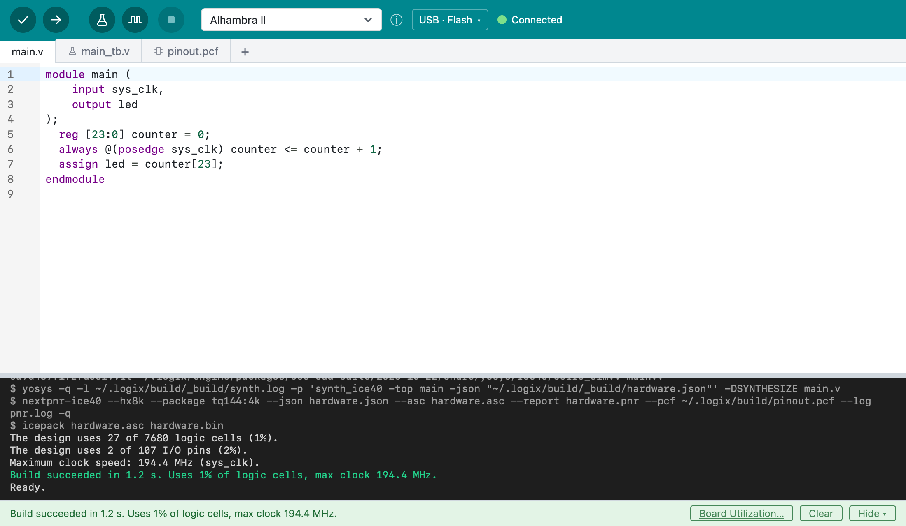
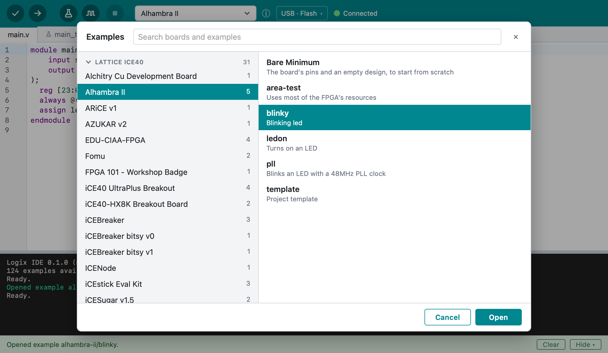
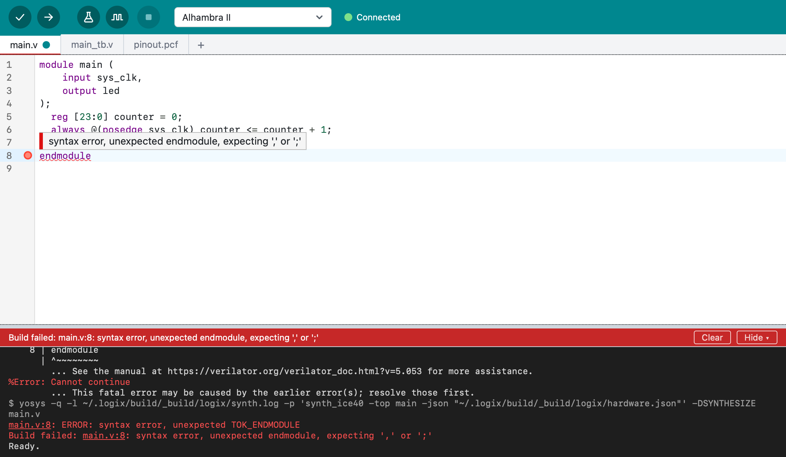
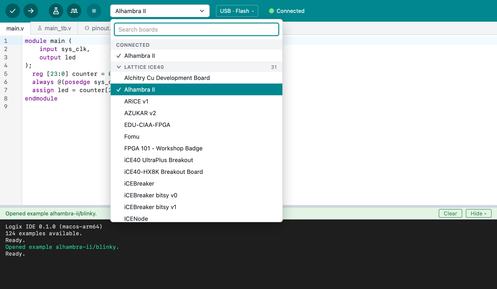
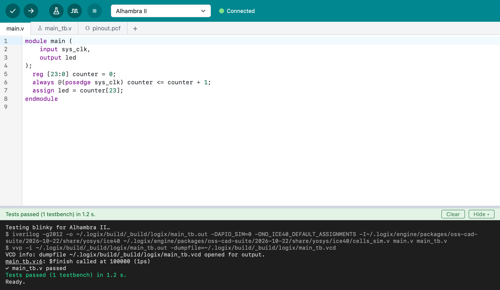
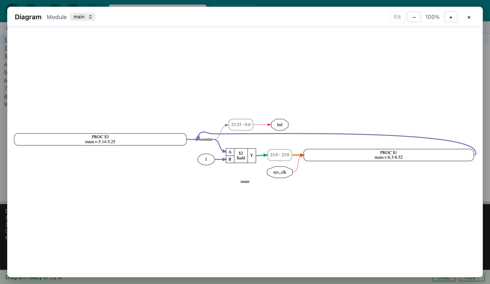

# A tour of Logix

A short walk through Logix for new users: what it is, what's on the screen,
and the path from an idea to a programmed board. Each part links to the page
with the details.

## What Logix is

**The Arduino experience, for FPGAs.** If you've used the Arduino IDE,
Logix will feel familiar: you write code, click **Verify** to check it, and
click **Upload** to put it on your board. The difference is the language:
you write **Verilog**, which describes hardware, instead of C++.



## Why it's easy to start

- **One installer.** No Python, package managers or toolchain setup.
- **The FPGA tools come by themselves.** On its first start, Logix downloads
  the open source FPGA tools it needs. You never have to learn or install
  them yourself.
- **Learn by example.** More than 110 examples for over 80 boards.

To get it, see [Installing Logix](installing.md).

## The toolbar

| Button | | What it does |
| :---: | :--- | :--- |
| { .toolbar-icon } | **Verify** | Checks the design and builds it |
| { .toolbar-icon } | **Upload** | Builds the design and programs the board |
| { .toolbar-icon } | **Run Tests** | Runs all the project's testbenches |
| { .toolbar-icon } | **Simulate** | Shows the signals in GTKWave |
| { .toolbar-icon } | **Stop** | Stops whatever is running |
| | Board list | Picks your board; the ones you used recently come first |
| | ⓘ | Shows the board in the Board Explorer: its FPGA, pins and examples |

Below the toolbar are a tab for each file, the editor and the output, and at
the bottom of the window a status line that says what Logix is doing. Mistakes in the grammar, like a
missing `;`, are underlined as you type.

## A project is a folder

The main file is always `main.v`, and its module is named `main`. Other
Verilog files and the board's pin file show up as tabs, and testbenches end
with `_tb.v`. New projects go to `~/Documents/Logix`.

This is blinky, the first example to try. A counter counts clock
cycles, and its top bit drives the LED, so the LED blinks:

```verilog
module main (
    input sys_clk,
    output led
);
  reg [23:0] counter = 0;
  always @(posedge sys_clk) counter <= counter + 1;
  assign led = counter[23];
endmodule
```

More in [Using Logix](using-logix.md#projects).

## Start from an example

**File > Examples…** lists the examples for each board, with a search box.
Every board's list starts with **bare-minimum**: the board's pins and a
design that does nothing yet, to start from scratch. Choosing a board never
changes your files.



## Verify: check, build, report

The **Verify** button { .toolbar-icon } checks the design for common mistakes, builds it for your board,
and reports how much of the FPGA it uses and how fast it can run. A mistake
is marked on its line; hover over the mark to read it, or click the
`file:line` link in the output to jump there.



## Upload: put it on the board

Plug the board in by USB. Next to the board list, Logix says **Connected**.
Click the **Upload** button { .toolbar-icon }: Logix builds the design, shows how much of the FPGA it
uses, and programs the board. If it can't find the board,
**Tools > Connected Devices…** shows what's plugged in, and
[Troubleshooting](troubleshooting.md#upload-cant-find-the-board) has tips.



## Test without a board

A **testbench** drives your design's inputs and checks its outputs, with no
board needed. The **Run Tests** button { .toolbar-icon } runs them all and shows each result;
the **Simulate** button { .toolbar-icon } shows the signals over time in GTKWave. Most examples come with
a testbench. More in [Testbenches and simulation](testbenches.md).



## See what you built

**Project > Show Diagram** draws your design's modules and
signals: a good way to check that the hardware you described is the
hardware you meant.



## Your first blink

1. Pick your board in the toolbar.
2. On the start screen, click **Examples…** (or **File > Examples…**),
   then open blinky.
3. Click the **Verify** button { .toolbar-icon }.
4. Click the **Upload** button { .toolbar-icon }. The LED blinks.

The [Quick start](quick-start.md) walks through it step by step.
