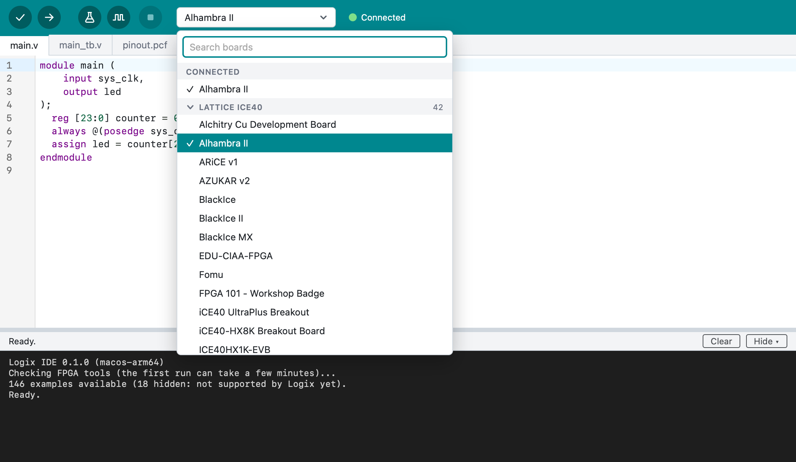
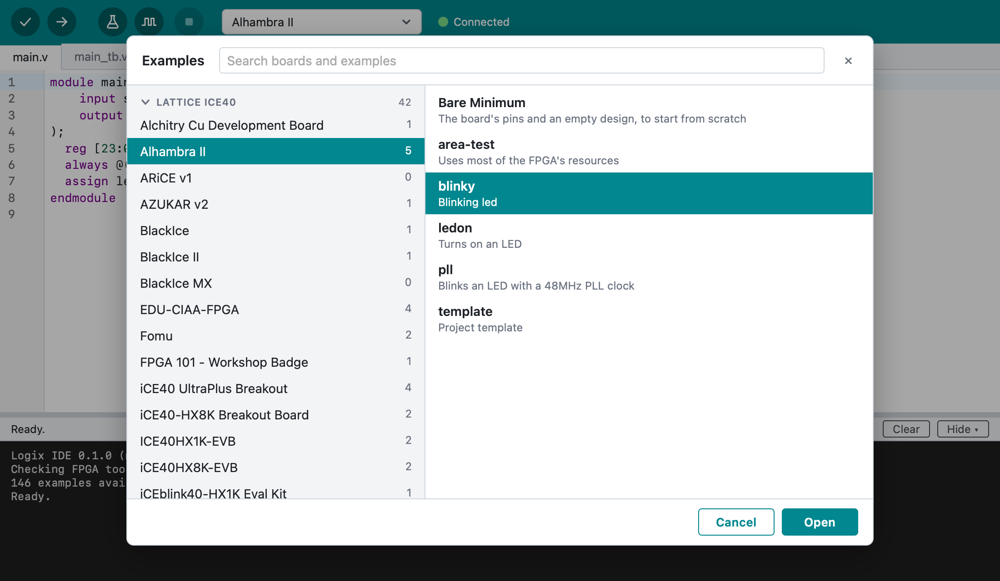
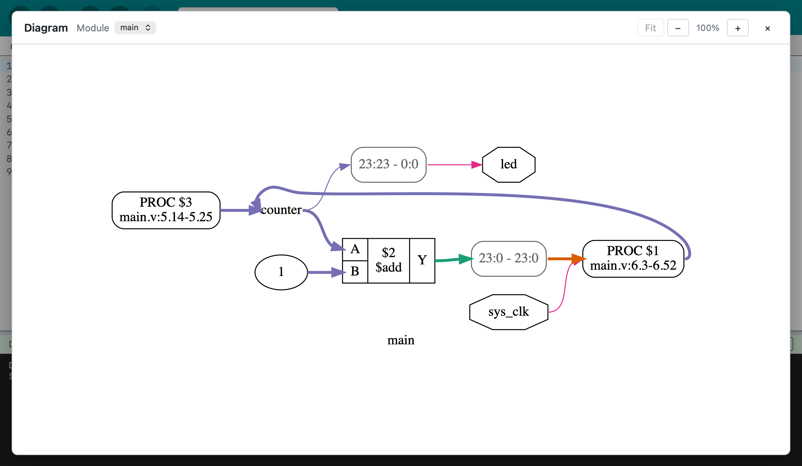
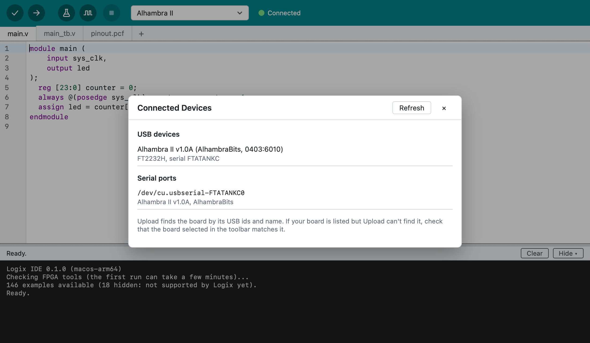
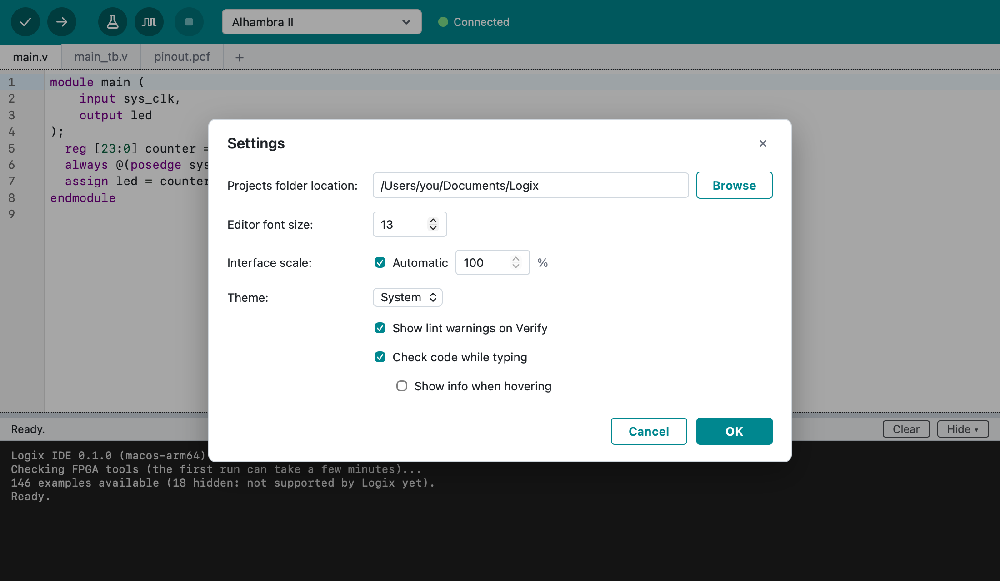

# Using Logix

## The window

- **Toolbar**: **Verify**, **Upload**, **Run Tests**, **Simulate**, **Stop**,
  and the board list.
- **Tabs**: one per file of the project. A dot marks unsaved changes.
- **Editor**: Verilog and SystemVerilog with syntax colors. Mistakes in the
  grammar (a missing `;`, a misspelled keyword) are underlined as you type.
  Other problems, such as a name that isn't declared, are found by Verify
  and marked when you click it. Hover over a mark to read it. If you turn it
  on in Settings, hovering over a name shows what it is.
- **Right-click** in the editor for **Go to Definition** (jump to where the
  name you clicked is defined), Cut, Copy, Paste, **Comment/Uncomment** and
  Auto Format. The same items are in the **Edit** and **Tools** menus.
- **Status bar**: while Logix is busy (checking the tools, verifying,
  uploading, opening an example…), a spinning circle and what it's doing.
  When it's done, the result, e.g. "Build succeeded…", or **Ready.**
- **Output**: what the FPGA tools print. References like `main.v:12` are
  links to that line. Click in it and press ++cmd+a++ to select all of it
  and ++cmd+c++ to copy, or right-click for **Copy**, **Select All** and
  **Clear Output**. Drag the bar above it to resize it, or hide it with
  **View > Toggle Output** (++cmd+j++); it comes back when you Verify,
  Upload, Run Tests or Simulate.

## Projects

A project is a folder. Its main file is always `main.v` (or `main.sv` for
SystemVerilog), and the design's top module must be named `main`. Other
files in the folder show up as tabs:

- more Verilog or SystemVerilog files (`.v`, `.sv`, `.vh`, `.svh`),
- the board's pin file (`.pcf`, `.lpf`, `.cst`, `.xdc`, `.pdc` or `.ccf`),
- testbenches (`*_tb.v`, see [Testbenches and simulation](testbenches.md)).

Logix also keeps a small `logix.json` with the project's board. You don't
need to edit it.

Other files and subfolders in the project folder are kept as they are, and
data files (such as memory contents) go along to the build. Verilog and pin
files inside subfolders aren't part of the design: Logix only builds the
ones at the top of the folder. Keep each project in its own folder, not
inside another project.

- **New project**: **File > New** (++cmd+n++) starts from the selected board's
  basic example (blinky). To start from scratch instead, open the board's
  **Bare Minimum** (see below).
- **New file**: the **+** at the end of the tabs, or **File > New File…**
  (++shift+cmd+n++). Double-click a tab to rename it; right-click it to
  rename or delete it. These changes, like edits, are saved when you save
  the project.
- **Open and save**: **File > Open…**, **Open Recent**, **Save**, **Save As…**.
  Logix reopens the last project when it starts; otherwise it starts a new
  project for the last board you chose (the **Alhambra II** the first
  time).
- **Show Project Folder**: **Project > Show Project Folder**
  (++option+cmd+k++) opens the folder in Finder.

## Boards and examples

Choose the board in the toolbar's board list; the project remembers it. Click
it to see all boards, grouped by FPGA type (Lattice iCE40, Lattice ECP5,
Gowin, Xilinx), and type to search. Click a group's name to open or close
it; the group of the current board opens by itself. The arrow keys and
++enter++ work too.

As in the Arduino IDE, choosing a board doesn't change your files: Logix
offers the board's examples, and **Keep Current Files** (or ++esc++) just
switches the board. Choosing the current board again is a quick way to get
to its examples.

Boards plugged in by USB are listed first, under **Connected**, and the word
next to the list (**Connected** or **Not connected**) tells whether the
selected board is plugged in. Some boards use a common USB chip that can't
tell which board it is; they're not listed under Connected, but Upload still
finds them.

**File > Examples…** lists the examples for each board, with a search box.
The boards are grouped by FPGA type in the same way.

Every board's list starts with **Bare Minimum**, as in the Arduino IDE: the
board's pins (from its basic example) and a design that does nothing yet.
Its outputs are set to 0 so that it builds; replace that with your design.

An example opens as a new, unsaved project; saving it asks where to put it.
A few of the examples that come with the FPGA tools use features Logix
doesn't support yet, so they're not listed.

## Verify and Upload

**Verify** (++cmd+r++):

1. checks the design for common mistakes (lint): warnings are shown in
   yellow and don't stop the build,
2. builds it for the selected board,
3. shows how much of the FPGA it uses and the maximum clock speed.

**Upload** (++cmd+u++) builds the design, shows the same usage tables, and
programs the board.

Both use the files as they are in the editor, saved or not. **Stop**
(++cmd+period++) stops a build or upload that takes too long.

## Auto Format

**Tools > Auto Format** (++cmd+t++) tidies up the indentation and spacing of
the open Verilog file. Undo (++cmd+z++) restores the previous text.

## Diagram

**Project > Show Diagram** (++shift+cmd+d++) draws the design's modules and
signals. Choose another module in the window to draw just that one.

## Connected devices

**Tools > Connected Devices…** lists the USB devices and serial ports
connected to the computer, which helps when Upload can't find the board.

## Help

The **Help** menu links to these pages, the keyboard shortcuts and
troubleshooting, and to the Apio documentation for going further.
**Report a Problem** opens a new report on GitHub, and **Show Log Folder**
opens the folder with Logix's log, to attach to a report (see
[Troubleshooting](troubleshooting.md#still-stuck)).

## Settings

**Logix IDE > Settings…** (++cmd+comma++):

- **Projects folder location**: where new projects go.
- **Editor font size**.
- **Interface scale**: make everything bigger or smaller.
- **Theme**: System, Light or Dark.
- **Show lint warnings on Verify**: turn off to skip the lint step.
- **Check code while typing**: underline syntax errors as you type. On by
  default.
    - **Show info when hovering**: hovering over a name shows what it is,
      e.g. its type. Off by default.

## Keyboard shortcuts

| Action | Shortcut |
| :--- | :--- |
| New project | ++cmd+n++ |
| Open project | ++cmd+o++ |
| Examples | ++shift+cmd+e++ |
| New file | ++shift+cmd+n++ |
| Save / Save As | ++cmd+s++ / ++shift+cmd+s++ |
| Verify | ++cmd+r++ |
| Upload | ++cmd+u++ |
| Run Tests | ++shift+cmd+t++ |
| Simulate | ++option+cmd+t++ |
| Stop | ++cmd+period++ |
| Show Diagram | ++shift+cmd+d++ |
| Show Project Folder | ++option+cmd+k++ |
| Auto Format | ++cmd+t++ |
| Toggle Output | ++cmd+j++ |
| Comment/Uncomment lines | ++cmd+slash++ |
| Go to Definition | ++f12++ (on a Mac keyboard, ++fn+f12++) |
| Settings | ++cmd+comma++ |
| Close Window | ++cmd+w++ |
