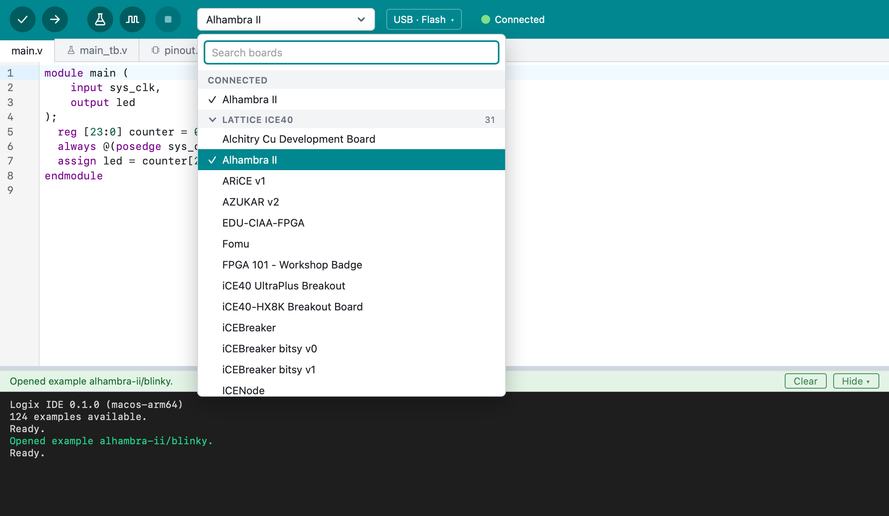
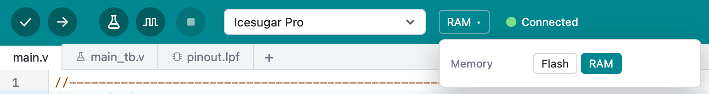
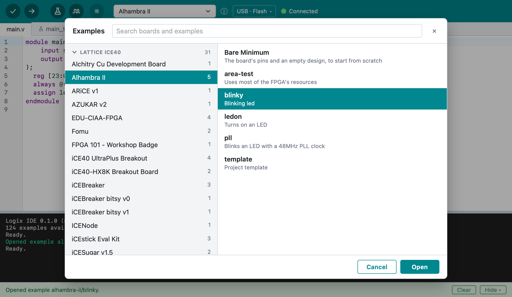
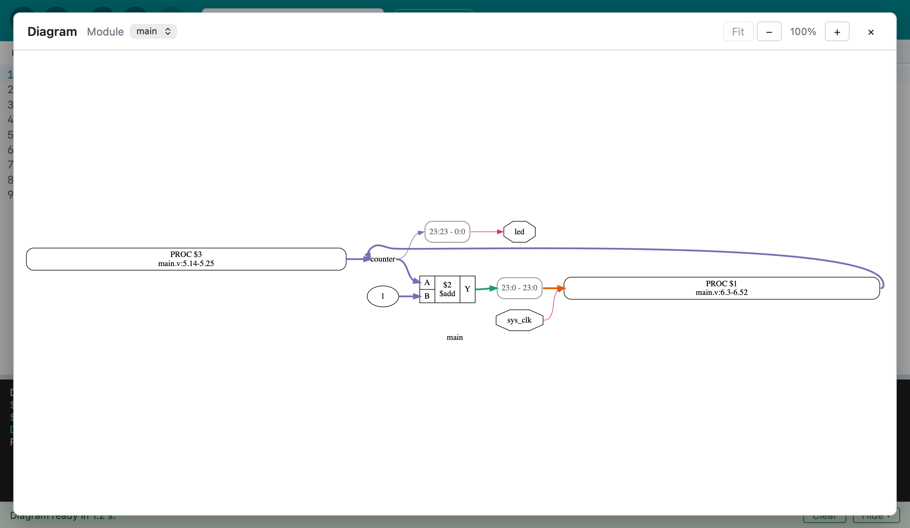
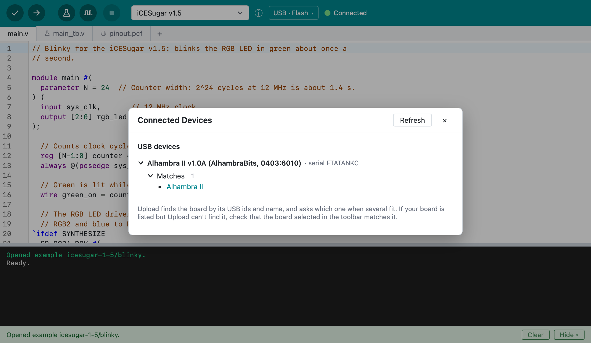
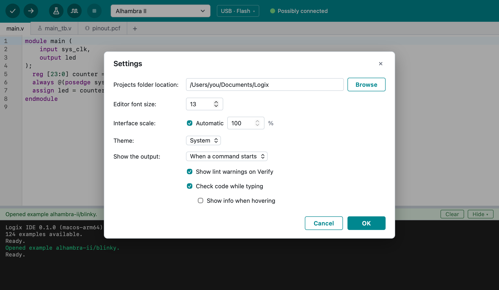

# Using Logix

## The window

- **Toolbar**: **Verify** { .toolbar-icon }, **Upload** { .toolbar-icon },
  **Run Tests** { .toolbar-icon }, **Simulate** { .toolbar-icon },
  **Stop** { .toolbar-icon }, and the board list.
- **Tabs**: one per file of the project. A dot marks unsaved changes. A
  flask marks testbenches and a chip marks the board's pin file (a pin file
  for another kind of board has no chip, since this board doesn't use it); hover over a tab to
  see what its file is for.
- **Editor**: Verilog and SystemVerilog with syntax colors. Mistakes in the
  grammar (a missing `;`, a misspelled keyword) are underlined as you type.
  Other problems, such as a name that isn't declared, are found by Verify
  and marked when you click it. Hover over a mark to read it. If you turn it
  on in Settings, hovering over a name shows what it is.
- **Right-click** in the editor for **Go to Definition** (jump to where the
  name you clicked is defined), Cut, Copy, Paste, **Comment/Uncomment** and
  Auto Format. The same items are in the **Edit** and **Tools** menus.
  **Comment/Uncomment** also works in pin files, with their
  own comment mark (`#`, or `//` in `.cst` files); Auto Format is for
  Verilog files only.
- **Status bar** (at the bottom of the window): while Logix is busy (checking the tools, verifying,
  uploading, opening an example…), a spinning circle and what it's doing.
  When it's done, the result, e.g. "Build succeeded…", or **Ready.**
- **Output**: what the FPGA tools print. References like `main.v:12` are
  links to that line. Select text in it and copy it as usual, or
  right-click for **Copy**, **Select All** and **Clear Output**. Drag the bar above it to resize it. To hide it, drag
  the bar all the way down, click **Hide**, or use **View > Toggle Output**;
  it comes back with **Show**, by dragging the bar up, and by default when
  you Verify, Upload, Run Tests or Simulate (see **Show the output** in
  Settings).

## Projects

A project is a folder. Its main file is always `main.v` (or `main.sv` for
SystemVerilog), and the design's top module must be named `main`. Other
files in the folder show up as tabs:

- more Verilog or SystemVerilog files (`.v`, `.sv`, `.vh`, `.svh`),
- the board's pin file (`.pcf`, `.lpf`, `.cst`, `.xdc`, `.pdc` or `.ccf`),
- testbenches (`*_tb.v`, see [Testbenches and simulation](testbenches.md)).

Logix also keeps a small `logix-ide.toml` with the project's settings, such
as its board. You don't need to edit it, but you can add comments (lines
starting with `#`); Logix keeps them.

Other files and subfolders in the project folder are kept as they are, and
data files (such as memory contents) go along to the build. Verilog and pin
files inside subfolders aren't part of the design: Logix only builds the
ones at the top of the folder. Keep each project in its own folder, not
inside another project.

- **New project**: **File > New Project > Empty Project** gives
  the selected board's pin file and an empty design (the board's **Bare
  Minimum**), ready to build. **File > New Project > From Example…**
  starts from one of the board's examples instead.
- **New file**: the **+** at the end of the tabs, or **File > New File…**.
  Double-click a tab to rename it; right-click it to
  rename or delete it. These changes, like edits, are saved when you save
  the project.
- **Open, close and save**: **File > Open Project…**, **Open Recent**,
  **Close Project**, **Save Project**, **Save Project As…**.
  Logix reopens the last project when it starts, unless you closed it.
  With no project open, the start screen offers a new project, opening a
  project or an example, and your recent projects;
  the board in the toolbar is the one new projects use.
  **Save As…** over an existing project replaces it; the old one goes to
  the Trash.
- **Show Project Folder**: **Project > Show Project Folder** opens the
  folder in Finder.

## Boards and examples

Choose the board in the toolbar's board list; the project remembers it. Click
it to see all boards, grouped by FPGA type (Lattice iCE40, Lattice ECP5,
Gowin, Xilinx), and type to search. Click a group's name to open or close
it; the group of the current board opens by itself. The keyboard works
too.

As in the Arduino IDE, choosing a board doesn't change your files: Logix
offers the recent projects for that board and the board's examples, and
**Keep Current Files** just switches the board. Choosing the current board again is a quick way to get
to its examples.

Boards plugged in by USB are listed first, under **Connected:** and the
name of the device they were found on. A device is one board, so several
boards under one device are the boards it may be, most likely first, since
different boards can look the same over USB. Boards that are only weak
matches aren't listed there unless one of them is selected; Tools >
Connected Devices counts them, and Upload still finds them. The words next
to the list (**Connected** or **Not connected**) tell whether the selected
board seems to be plugged in; Upload then checks. Click them to see the
connected devices.

### Board options

Next to the board, Logix shows how it's programmed: the connection (such
as **USB**, the board's own USB port) and where the design goes (**Flash**
or **RAM**). Click it to see what each means. Many boards can be
programmed in more than one way: through different USB adapters (such as
the ColorLight i9 or the ButterStick), or into flash or RAM (such as the
iCESugar-Pro or the Arty A7); for these, choose the option there or under **Tools**. The
project remembers it.

- **Flash** keeps your design when the board is powered off.
- **RAM** uploads faster, but the design is lost when the board is powered
  off.

If an option hasn't been tried on a real board yet, the panel says so under
**Note**. If you try it, please report whether it works.

Boards that can upload to flash do so unless you choose **RAM**. On many
boards, such as the Xilinx boards, flash hasn't been tried yet. A few
upload to RAM only, such as the Zybo and PYNQ boards and the ULX3S. After
**Upload**, the output says where the design went.

**File > New Project > From Example…** lists the examples for each board, with a search box.
The boards are grouped by FPGA type in the same way.

Every board's list starts with **Bare Minimum**, as in the Arduino IDE: the
board's pins (from its basic example) and a design that does nothing yet.
Its outputs are set to 0 so that it builds; replace that with your design.

An example opens as a new, unsaved project; saving it asks where to put it.
A few of the examples that come with the FPGA tools use features Logix
doesn't support yet, so they're not listed.

## Verify and Upload

The **Verify** button { .toolbar-icon }:

1. checks the design for common mistakes (lint): warnings are shown in
   yellow and don't stop the build,
2. builds it for the selected board,
3. shows how much of the FPGA it uses and the maximum clock speed.

The **Upload** button { .toolbar-icon } builds the design, shows the same usage tables, and
programs the board. If several connected devices could be the board (for
example two of the same board), Upload asks which one to use.

Both use the files as they are in the editor, saved or not. The **Stop**
button { .toolbar-icon } stops a build or upload that takes too long.

## Auto Format

**Tools > Auto Format** tidies up the indentation and spacing of
the open Verilog file. **Edit > Undo** restores the previous text.

## Diagram

**Project > Show Diagram** draws the design's modules and
signals. Choose another module in the window to draw just that one.

## Connected devices

**Tools > Connected Devices…** lists the USB devices connected to the
computer, which helps when Upload can't find the board. Each device says
which boards it looks like, and how many other boards it may be (click
the number to list them). Click a board's name to select it.

## Help

The **Help** menu links to these pages, the keyboard shortcuts and
troubleshooting.
**Report a Problem** opens a new report on GitHub, and **Show Log Folder**
opens the folder with Logix's log, to attach to a report (see
[Troubleshooting](troubleshooting.md#still-stuck)).

## Settings

**Logix IDE > Settings…**:

- **Projects folder location**: where new projects go.
- **Editor font size**.
- **Interface scale**: make everything bigger or smaller.
- **Theme**: System, Light or Dark.
- **Show the output**: when the hidden output comes back by itself: **When
  a command starts** (Verify, Upload, Run Tests or Simulate; the default),
  **Only on errors**, or **Never automatically**.
- **Show lint warnings on Verify**: turn off to skip the lint step.
- **Check code while typing**: underline syntax errors as you type. On by
  default.
    - **Show info when hovering**: hovering over a name shows what it is,
      e.g. its type. Off by default.

## Keyboard shortcuts

| Action | Shortcut |
| :--- | :--- |
| New empty project | ++cmd+n++ |
| New project from an example | ++shift+cmd+e++ |
| Open project | ++cmd+o++ |
| Close project | ++cmd+w++ |
| New file | ++shift+cmd+n++ |
| Save / Save As | ++cmd+s++ / ++shift+cmd+s++ |
| Verify | ++cmd+r++ |
| Upload | ++cmd+u++ |
| Run Tests | ++shift+cmd+t++ |
| Simulate | ++option+cmd+t++ |
| Stop | ++cmd+period++ |
| Show Diagram | ++shift+cmd+d++ |
| Show Project Folder | ++option+cmd+k++ |
| Auto Format | ++cmd+t++ |
| Toggle Output | ++cmd+j++ |
| Comment/Uncomment lines | ++cmd+slash++ |
| Select All (editor or output) | ++cmd+a++ |
| Go to Definition | ++f12++ (on a Mac keyboard, ++fn+f12++) |
| Settings | ++cmd+comma++ |
| Close Window | ++shift+cmd+w++ |
